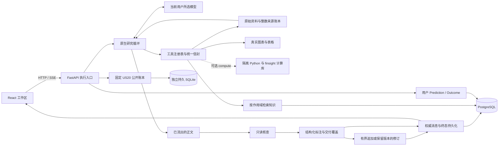

<p align="center"></p>
<h1 align="center">FinSight AI</h1>
<p align="center"><strong>可信行情、可验证 AI 判断与证据化金融研究</strong></p>

FinSight 用真实行情、财报、新闻和可回读来源支持提问、追问、股票比较、研究报告和预测复盘。主工作区为 Today、Dashboard、Chat、History，公开战绩和只读分享保持独立。组合管理、筛选、回测与自动交易不属于当前产品。

更新：2026-11-13。本文与当前源码一致；研究模型已按用户选择配置为 APIKL `gpt-6.1-terra`，原生工具和 SSE 探针通过。完整同题回放、48 项产品验收和新运行时部署正在执行，实际发布身份与验证结果以[生产运行手册](docs/11_PRODUCTION_RUNBOOK.md)为准。

## 开发与部署入口

Python 3.11+、Node.js 20.19+ 或 22.12+；使用当前 npm 锁文件。真实配置放入被忽略的环境文件。

```bash
python -m pip install -r requirements.txt
# 先配置开发数据库 FINSIGHT_POSTGRES_DSN 并完成 Alembic migration。
python scripts/run_agent_runtime.py --env-file .env.runtime.local
npm ci --prefix frontend
npm run dev --prefix frontend
```

服务端配置参考 `.env.server.example`，完整容器环境使用 `docker compose --env-file .env.server up -d --build`。生产发布还需要已迁移数据库、真实认证、质量/容量与回滚检查，详见[贡献指南](CONTRIBUTING.md)和[运行手册](docs/11_PRODUCTION_RUNBOOK.md)。默认配置不下载本地 embedding/reranker；开放代码由独立 compute profile 执行。

## 源码与文档地图

| 路径 | 当前用途 |
|---|---|
| backend/api | HTTP/SSE、认证、owner、参数与受理 |
| backend/agent_runtime | 主/专业角色循环、工具信封、数据、压缩、核查与交付 |
| backend/analysis_worker | 隔离作业及确定性 finsight 计算库 |
| backend/services / rag | 持久化、行情、独立预测和按作用域知识 |
| frontend/src | 页面、对话、按域状态、分域 API 和懒加载图表 |
| tests/agent_eval | 60 题固定评测、同资料回放、独立评分和冻结对照 |
| docs | 当前规范；archive 保存过时规范和历史证据 |

研究模型使用 `https://apikl.ai/v1` 与 `gpt-6.1-terra`，凭据留在本机/服务器私密配置。131072 上下文与 16384 输出是本轮显式运行预算，未声称供应商最大窗口；固定 US20 的模型与策略保持独立。此前请求的 gpt-6-luna 被接口明确拒绝，模型由用户重新指定，详见[模型规范](docs/MODEL_SELECTION.md)。

## 当前能力与边界

| 范围 | 当前实现 |
|---|---|
| 自主研究 | 唯一原生工具调用循环；主研究员与专业角色共用模型协议、资料和预算，工具能力不支持时明确拒绝 |
| 工具与技能 | `ToolResult` 统一信封；Markdown 技能目录供用户选择及模型 `load_skill`，技能不增加权限 |
| 资料与来源 | 原始记录按 owner/session/run 隔离，来源采用整数编号；`read_data` 分页回读，`run_python` 在隔离计算服务重算 |
| 图表与表格 | `render_chart`、`render_table` 从真实句柄生成产物；数值直接来自保存的数据，不依赖模型重抄 |
| 只读核查 | 数据回答默认核查，报告必须核查；核查员只提交 findings/coverage，最多 4 轮、45 秒，不改已显示正文 |
| 修订与补交 | 聊天问题标注后由用户点“按核查意见修订”；缺少交付事项可自动追加一次，报告可在发布前修订一次并保留旧版本 |
| 过程与交付 | 正文、工具、产物和核查按真实事件展示；正文完成先可读，核查与持久化结束后交付唯一终态 |
| 预测战绩 | 用户 Prediction/Outcome 与固定 US20 公开账本分别采样、存储和评分；冻结预测协议不随研究重构改变 |
| 知识库 | memory / working set / knowledge base；默认词法检索，可选托管语义 API 或独立 local-ml worker |

## 架构



当前生产入口只依赖 `backend/agent_runtime/`，不保留旧研究运行时选择开关。旧图与已退役源码用于 `tests/agent_eval/reference/` 对照，排除在生产镜像之外；27 个冻结预测依赖按清单保留，不能因目录名含旧架构就删除。

主研究员可以通过 `spawn_agents` 并行委派，专业角色不能嵌套。核查员复用同一循环但只开放 `read_data/run_python/submit_review`，使用同一用户身份和共享额度；换核查模型必须显式传入，不能借用其他用户凭据。

## 数据、权限与恢复

- owner 只来自已验证身份，客户端 body、session、UI 上下文和外部资料不能授权跨用户读取或写操作。
- 自选增删通过结构化提案与确认卡执行；显式“自选增删免确认”账户设置可复用授权，不从自然语言关键词猜测同意。
- 私有思考按账户设置展示、限制长度并与公开正文分离；核查员的内部推理不公开。
- unknown 单位、财期、复权、股息或来源时间保持未知；工具失败、核查不可用与“资料不足以核实”分别处理。
- 会话、权威消息、研究终态、报告与用户 Prediction/Outcome 以 PostgreSQL 为事实源。短期资料文件、额度/操作收据 SQLite 和固定公开账本各有独立用途。
- 当前仍要求单 API 进程/副本；持久终态不代表已经实现跨实例运行任务、取消或配额调度。
- 断线恢复读取同 owner/session/run 的已提交 blocks 与终态，不重新发起付费研究。报告修订保留 `revision_of`，用户发起的新轮修订保存 `review_revision` 关系。

## 配置与部署

配置模板为 `.env.example` 与 `.env.server.example`。研究使用 `FINSIGHT_AGENT_API_BASE/MODEL/API_KEY`；Step 5 按量选项使用独立 `FINSIGHT_AGENT_STEPFUN_API_KEY`，不覆盖 Step Plan 或冻结预测默认。用户自带模型优先，未知模型使用保守预算，详情见[模型选择](docs/MODEL_SELECTION.md)。

默认 Compose 运行 PostgreSQL、API 和前端；`compute`、`local-ml` 均为显式可选 profile。开放 Python 不回退到 API 进程；计算未配置、资源不足或缺少 result 都要如实返回。模型、认证与计算密钥只通过安全配置或环境变量提供，不写入仓库、镜像构建参数或公开诊断。

本地运行入口为 `scripts/run_agent_runtime.py`；它显式加载本地配置。正式启动需要匹配的数据库 schema、认证及 provider 配置。镜像身份、迁移、容量检查、发布与回滚操作统一见[运行手册](docs/11_PRODUCTION_RUNBOOK.md)，文档更新不触发安装、迁移或重启。

## 验证与阅读入口

评估位于 `tests/agent_eval/`：固定题集和工具回放、独立内容评分、核查员注错与未注错样本分开计分。M3 的质量与耗时对比、M4 检出率/误报率、浏览器验收和真实生产会话必须分别提供证据。原始 before 不因新代码或 fixture 通过而改判。

- [当前架构](docs/01_ARCHITECTURE.md) · [Agent 指南](docs/AGENTS_GUIDE.md) · [事件合同](docs/execution-event-contract.md)
- [只读核查与事实治理](docs/HALLUCINATION_MITIGATION.md) · [报告与图表](docs/REPORT_CHART_SPEC.md)
- [RAG](docs/05_RAG_ARCHITECTURE.md) · [固定公开预测账本](docs/PREDICTION_TRACK_RECORD.md)
- [设计合同](DESIGN.md) · [文档索引](docs/DOCS_INDEX.md) · [LangGraph 历史定位](docs/archive/2026-11-13_documentation_refresh/LANGGRAPH_FLOW.md)
- [历史实施发布](docs/reports/2026-11-07_agent_runtime_implementation.md) · [历史真实 before](docs/reports/2026-11-07_natural_response_compute/BEFORE.md) · [历史研究恢复](docs/reports/2026-11-08_research_recovery/LIVE_RESEARCH.md)

## 免责声明

本项目用于金融研究和工程实践，输出不构成投资建议。
