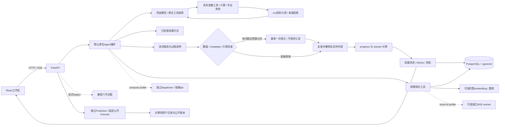

<p align="center"></p>
<h1 align="center">FinSight AI</h1>
<p align="center"><strong>可信行情、可验证 AI 判断与证据化金融研究</strong></p>

FinSight 用真实行情、财报、新闻和可回读来源帮助用户提问、追问、比较股票、阅读研究报告与核对预测。主工作区为 Today、Dashboard、Chat、History；公开战绩与只读分享保持独立。组合管理、筛选、回测与自动交易不属于当前产品。

更新时间：2026-11-08。当前主应用（后端与前端）为 `agent-20261108-365a20081c6b`，代码基线 `ddee6360`；独立 compute 保持 `python-20261107-a0b8e1d70e82`。均已部署，源码已提交推送。发布身份与验证范围见[本次记录](docs/reports/2026-11-08_research_recovery/LIVE_RESEARCH.md)。

当前版本使用过程/答案分离、当前问题证据检查、有界修正和真实数据交付。数字、财期、区间和来源可回读；明确重新检索会产生本轮新尝试。公开检查、容器内研究验证与受保护HTTP/本人OAuth验收分别记录，不能互相替代。

## 当前能力

| 范围 | 实现与边界 |
|---|---|
| 自主研究 | 默认原生工具调用和真实模型增量；按证据决定取数、计算、图表与专业分工，模型不支持工具调用时拒绝研究 |
| 工具与技能 | 逐项真实对象/结果、参数/来源详情，与正文按seq穿插；7个已安装技能供输入 `/` 菜单及主/专业Agent use_skill，方法不增加权限 |
| 过程与答案 | `content_phase=progress/answer` 分离安全过程说明与正式回答；复制/后续回答历史只用最终答案，旧候选被清空后不生成逐段“已撤回”占位 |
| 思考与历史 | 默认展示供应商真实reasoning，单run含子Agent最多20,000字符，owner私有消息/快照保存；历史可展开，不进金融证据、引用、公开报告或日志 |
| 自然追问 | 自动沿用同会话有效资料，每条记录TTL不续期；涉及最新行情重新取证，无常驻继续按钮 |
| 图表与计算 | 真实数据表、共同基准比较、连续下跌区间；`coverage` 显示缺值与首个有效点。Python 只进入隔离 job，提供日志、代码错误和 `get_frame`，容量不足仍拒绝 |
| 金融数据 | 行情/财务/新闻保留主体、财期、币种、来源与时点；日收盘不叫即时价，Yahoo扩展时段覆盖04–20 ET，FINRA周场外统计通常延迟2–4周，不是实时暗盘或净流入 |
| 看板与右栏 | Today与Dashboard提供真实个人摘要/行情；对话右栏为本轮标的、236px走势、实际指标与引用的单列，只有已核验价位才画线 |
| 预测战绩 | 用户Prediction/Outcome与固定公共账本分开；范围/cohort统计和频率/阈值/版本取metadata，不修改冻结forecast算法 |
| 知识库 | memory / working set / knowledge base、PostgreSQL/pgvector、按需检索和授权票据回读；默认词法、可选托管embedding/重排或独立local-ml |
| 交付恢复 | 权威消息、blocks、checkpoint与终态按owner/run/message保存；重复恢复不重跑付费研究，保存失败保留预览 |

## 架构



主研究员与专业角色共用循环、预算、资料和权限；只允许主研究员委托，不嵌套。六节点 LangGraph 通过 `FINSIGHT_RESEARCH_RUNTIME=legacy` 显式保留，不再是默认研究主链。引用只投影有界来源字段和data_ref，完整OHLC保存在原始记录；生成图表不能替代正文口径与来源校验。

`inspect_dataset` 默认只查看标量列、日期和 `column_units`，最多 12 行，并受 8000 的保守上下文预算约束；过大的嵌套资料改用显式列选择或原文回读。图表保留每个字段的 `points/valid/missing/leading_missing/first_valid/last_valid`。续研目录只列 `success` 且有 `source_refs` 的资料，旧失败/control 回执不当证据；`prior_artifacts` 明确是历史投影，不将旧图重新交付为新产物。

## 数据与权限

- 服务端owner来自已验证Supabase身份，body/session/UI不能覆盖；会话、资料、运行回放、操作确认与私有报告分别校验作用域。
- 默认思考是供应商字段，不能由应用进度文案伪造；同run总20k和owner边界在流式与保存层双重限制。
- unknown复权/股息不改写成未复权或未含股息，freshness不冒充供应商延迟。无支持的候选内容被删除/修正；仍有问题时保留部分结果和限制说明，不能因不再显示撤回占位就宣称全文正确。
- 自选增删使用操作提案、payload hash与持久收据；完整用户指令可复用明确授权，网页、工具结果、文件和同伴消息不能授权。
- 业务会话、研究终态、报告、Watchlist和用户Prediction/Outcome以PostgreSQL为事实源；辅助资料缓存/额度/收据及固定公开账本不替代它。
- `done`、内容质量、publishable与persistence状态独立；质量不足报告不进入默认索引或公开分享。恢复旧run不重复付费执行。
- 原始Logo沿用README橙蓝K线F，七份设计HTML保持原样；不把原稿价格、胜率和来源数量复制为默认业务值。

## 启动与部署

配置参考 `.env.server.example` / `.env.example`。研究模型使用 `FINSIGHT_AGENT_API_BASE/MODEL/API_KEY`，托管向量与重排使用各自独立安全凭据；不要提交真实配置、把key作为构建参数或打印完整Compose展开值。

默认Compose运行PostgreSQL、API和前端，不启动 `rag-inference`。`local-ml` 与 `compute` 为显式可选profile；预测watchdog按既有授权启用，不因研究模型变化开启采集。当前隔离计算物理内存不足时会真实拒绝，不能回退在API进程执行开放代码。

计算的低内存配置显式开启 adaptive，设 job 最低 128 MiB、最高 256 MiB、保留 128 MiB，按 64 MiB 步长选择 128/192/256 MiB；不是使用 swap 兜底。代码和 Compose 的未配置默认值仍是固定 512 MiB job + 256 MiB 保留。实际启用状态看 compute `/health` 的配置与容量字段，不能仅凭 healthy 判断作业成功。

本地入口 `scripts/run_agent_runtime.py` 显式加载安全的本地配置。当前工作树已验证的参数检查如下，不加载配置或启动服务：

```powershell
chcp 65001 > $null
.omx/runtime-venv/Scripts/python.exe scripts/run_agent_runtime.py --help
```

完整服务需要匹配的PostgreSQL schema、Supabase与provider配置；本文未重新执行安装、数据库迁移或服务启动。实际发布目录、`-p finsight`、精确镜像/manifest、`--no-build`、恢复与回滚流程见[唯一生产Runbook](docs/11_PRODUCTION_RUNBOOK.md)，不要重跑前一版已经提交的RAG迁移。

## 路由与健康

`/today` 是默认入口；`/dashboard/:symbol?`查看行情，`/chat`提问，`/history`回看，`/share/r/:token`只读分享，`/track-record`分开核对个人/公开记录。Chat与History要求登录，公开页面不替代个人数据认证。

`/api/execute`是唯一研究SSE入口；研究与技能接口要求认证。当前公网版本、原Logo与GitHub登录入口已核对，无页面脚本错误；匿名POST研究请求返回401符合预期。完整本人OAuth与登录后的生产连续会话未验，不创建测试账号、启用内部密钥或绕过鉴权来补结果。

`/livez`只表示存活，`/readyz`是发布就绪门禁，`/health`为兼容状态。上一主发布检查曾确认ready/health200、RAG2228 semantic_ready/pending0/full_ready，以及AAPL公司资料/251根日线；当时公开战绩metadata正常但0记录。当前部署和数据状态须重新取证，计算容量与成功作业独立检查。

## 验证与证据

验证分为前后端代码回归、真实 PostgreSQL、隔离 Docker 计算、浏览器交互和真实模型任务；各自保留范围与源码身份，重叠测试不相加。具体计数、镜像构建与业务结果集中在[复验记录](docs/reports/2026-11-07_natural_response_compute/README.md)，不能用健康检查或构建成功代替完整回答验收。

真实多会话的 [before](docs/reports/2026-11-07_natural_response_compute/BEFORE.md) 与 after 分开记录；基线未整体通过，当前完整性结论以复验报告为准。`completed`、图表成功、fixture 或旧测试数量都不能代替逐项核对。

- [当前架构](docs/01_ARCHITECTURE.md) · [Agent指南](docs/AGENTS_GUIDE.md) · [执行事件合同](docs/execution-event-contract.md)
- [RAG架构](docs/05_RAG_ARCHITECTURE.md) · [显式legacy流程](docs/LANGGRAPH_FLOW.md)
- [实施与发布记录](docs/reports/2026-11-07_agent_runtime_implementation.md)
- [研究恢复与发布验收](docs/reports/2026-11-08_research_recovery/LIVE_RESEARCH.md) · [文案与截图](docs/reports/2026-11-08_research_recovery/README.md)
- [此前响应与计算复验](docs/reports/2026-11-07_natural_response_compute/README.md) · [冻结 before](docs/reports/2026-11-07_natural_response_compute/BEFORE.md)
- [页面对照](docs/reports/2026-11-07_page_design_alignment/PAGES_COMPARISON.md) · [对话与右栏对照](docs/reports/2026-11-07_chat_design_alignment/README.md) · [真实图表渲染](docs/reports/2026-11-07_chat_design_alignment/REAL_CHARTS.md)
- [结果、过程与图标验收](docs/reports/2026-11-07_chat_design_alignment/RESULT_PROCESS_ICONS.md)：前端 fixture 与真实 artifact 数值核对分开记录。
- [文档索引](docs/DOCS_INDEX.md) · [设计合同](DESIGN.md)

布局对照使用明确fixtures，金融图表使用真实模型artifact，线上probe和真实登录另验；三类证据各有边界。历史计划与旧规范在 `docs/archive/`，不作为默认运行事实源。

## 免责声明

本项目用于金融研究和工程实践，输出不构成投资建议。
