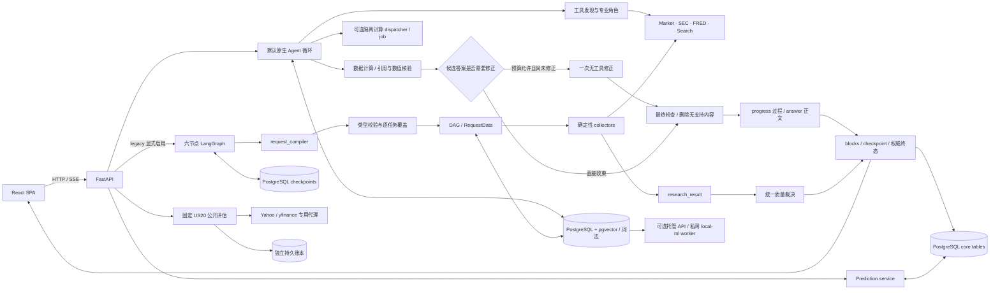
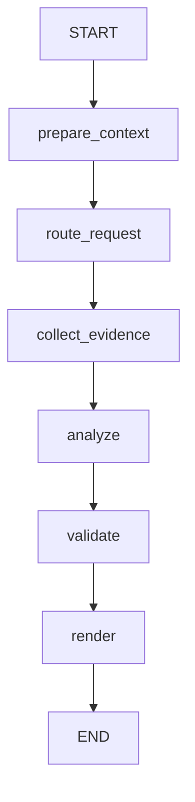

# FinSight 当前架构

更新时间：2026-11-07。本文描述当前代码行为；部署与验收状态分开记录。

## 1. 产品边界

FinSight 的产品目标是：先把与用户关注标的有关的变化摆到面前，再用可信行情、可验证 Prediction、证据化追问和历史复盘帮助用户理解公开金融信息。

当前主工作区为 Today、Dashboard、Chat、History；另有 Welcome/Login 与只读 Shared Report。右栏为本次对话标的、真实走势和引用的单列辅助面板，不再放执行/详情/战绩 tabs；`/track-record` 区分个人 Prediction 与固定公共账本。Today 是默认入口，登录用户可查看自选报价、最近 Prediction/Outcome 和待跟进判断；匿名用户只看到登录引导并可转到只读 Dashboard。Ask、Research、Portfolio、Library 是后续目标信息架构，不是当前已注册路由。

组合工作台、Screener、Backtest、A 股榜单、Attribution、Rebalance、独立 Morning Brief/Daily Tasks、邮件订阅、Alert Feed、RAG Inspector、Cost Audit、Skills/Agents/Tools 目录均不属于当前产品。

## 2. 运行时总览

FastAPI 注册以下业务 Router，具体操作以生成的 OpenAPI 为准：

| Router | 责任 |
|---|---|
| `system_router` | `/livez`、`/readyz`、`/health`、公开只读 `/api/capabilities` 与 `/metrics` |
| `user_router` | 当前用户只读资料 |
| `watchlist_router` | Watchlist 增删查 |
| `conversation_router` | 对话列表与历史 |
| `market_router` | quote、Kline、financials、news、Dashboard snapshot |
| `execution_router` | 唯一 Chat/Report SSE 执行、持久运行状态、回放、取消、追加要求、操作确认与续研 |
| `predictions_router` | 用户触发的 PostgreSQL PredictionTrack：generate、run、latest、history、detail、stats、Outcome 运维入口；保留旧账本地址的隐藏兼容入口 |
| `monitor_router` | 页面 lease 与当前标的 comments feed |
| `report_router` | 报告索引、回放、分享与公开只读读取 |
| `model_router` | 公开模型目录与能力、登录用户的连接测试 |
| `prediction_router` | 独立 `/api/benchmarks/us20-v1/track-record`：固定 US20 五日公开基准账本，只读 |
| `skill_router` | `/api/skills` 的已安装 manifest 目录，供用户 `/` 菜单和主/专业角色选取 |
| `auth_provider_router` | 公开 `/api/auth/providers`，读取实际登录 provider 设置，不将 UI 按钮当作 OAuth 已配置 |

其中 `/api/models`、`/api/models/capabilities`、`/api/models/test` 提供请求级模型配置；`/api/execute/runs/{run_id}` 提供持久研究运行状态；`/api/stock/company/{ticker}` 提供真实公司资料，`/api/auth/providers` 与 `/api/skills` 提供真实能力目录。`/api/benchmarks/us20-v1/track-record` 的只读范围视图按 range/ticker/type 与确认 cohort 聚合，并返回频率、阈值、时点、版本和下一对账日期 metadata；不改 forecast 核心。旧 `/api/predictions/track-record` 为隐藏兼容入口，不进入 OpenAPI。

聊天和研究报告的模型选择通过 `backend/services/model_selection.py` 进入研究调用链；原生运行时先用真实工具调用预检所选模型，不支持时要求更换模型。保持全站共享报告缓存停用。模型连接与身份边界见 [模型选择](MODEL_SELECTION.md)。

固定 US20 账本独立于用户的 PostgreSQL Prediction/Outcome：Technical 与 Risk 仅在显式定时 forecast 模式产出五日方向及回撤事件，使用独立预算、冻结输入和单源 Yahoo。公开评估记录写入持久卷中的 `prediction_ledger.db`，独立 watchdog 记录投递状态；这不恢复旧业务 SQLite/JSON 路径。两者采样和评分合同不同，不合并战绩或用户数据。详见 [公开预测账本](PREDICTION_TRACK_RECORD.md)。

## 3. 自主研究与兼容图

`backend/agent_runtime/config.py` 将 `FINSIGHT_RESEARCH_RUNTIME` 默认设为 `agent`。执行入口使用 `service.py` 适配现有 `RunContext`、权威消息和报告保存；`loop.py` 内主/专业研究角色共用模型流 → 原生工具调用 → 实际结果回传 → 下一轮模型的循环，由模型按证据决定步骤。

`tools.py` 校验工具和参数并合并同轮取数，`tool_display.py` 逐项注册真实对象/结果展示，`diagnostics.py` 投影脱敏参数、输出预览和失败建议。`data.py` 保存稳定原始引用并适配 SEC 平行数组、盈利预期多表；来源只保留有界字段和 data_ref，完整 OHLC 不复制到每条引用。模型可发现/启用工具、回读资料，也可从真实 7 项 builtin manifest 通过 `use_skill` 加载方法，技能不扩大权限或预算。只有主研究员派发专业角色，不嵌套委托。

`analysis.py` 提供区间统计、多标的共同基准比较、明确连续下跌规则与估值情景；未知参数拒绝，不将连续下跌当任意峰谷回撤。区间图按真实 ISO 日期对齐类目，包含结束观测及收益计算所需前一期基准。开放 Python 代码只进入独立 `backend/analysis_worker/`，资源不足明确不可用。`grounding.py` 共用金融数值核验，并检查交易所、复权、股息与来源延迟语义；unknown/null 和 freshness 不得被改写成确定事实。`presentation.py` 清理公开正文的供应商内部 DSML 标记，不能从文本解析执行工具。

`inspect_dataset` 默认省略嵌套对象/数组，只保留标量列、日期和来自指标 metadata 的 `column_units`；显式 `columns` 可选择需要的字段。返回默认 6 行、最多 12 行，序列化结果受 `tokens()` 的 8000 保守预算约束，过大时先缩减返回行数，再明确拒绝过大的单行投影；该估算以 UTF-8 字节数计，不是实际计费 token。

每个图表字段都有 `coverage`：总点数、有效/缺失点数、开头缺失点数、首末有效坐标。`limitations` 说明缺值，不能把均线起始空值补成零，也不能套用“前19点为空”而不核对实际图表。`RunData.restore()` 只为仍有有效数据引用的旧图保留最多 30 个 `prior_artifacts` 投影（spec/coverage/method/limitations 等），不复制旧图 rows 或重新发送为新 artifact。

多序列比较统一产出 `comparison_stats`；交叉由纯函数 `comparison_crossovers` 计算，初始持平后的首次分离不计，平局不重置领先方。该统计供后续文字检查使用；两期财报只支持一次期间变化，不能据此声称连续两个季度增长。

主研究员给出无工具调用的候选后可检查一次：有反馈且剩余时间超过 5 秒时，追加至多一次不带工具 schema 的修正，仍受原运行时间、token 与配额限制。修正轮若仍返回 `tool_calls` 也不执行。交付层选定唯一 `answer` block，早期安全文本为 `progress`；无支持内容通过递增 revision 删除，失败修正的半截输出不混进末答。系统只在末答仍有问题时补一条限制说明，保留 quality/answer_status；不逐段插入“已撤回”占位。详细字段见[事件合同](execution-event-contract.md)。

`permissions.py` 仅接受真实用户完整匹配操作和 ticker 的显式指令；其他自选增删需确认，`actions.py` 保存 owner/run/action 收据和 payload hash。工具、网页、文件及同伴消息不能授权。追加要求在模型边界应用；普通追问自动沿用同 owner/session 早于当前的终态 run 中仍有效的资料，逐记录 TTL 不续期，不添加人造续研问题或常驻继续 CTA。

给模型的续研 catalog 只包含 `status=success` 且有 `source_refs` 的记录；旧 `control`/失败回执即使为审计保留，也不列作可用研究资料。prior_artifacts 明确标为历史图表投影，不能作为当前轮新交付。

### Legacy Graph 与请求合同

显式 `FINSIGHT_RESEARCH_RUNTIME=legacy` 使用原六节点图；`backend/graph/runner.py` 是该图结构唯一事实源。以下 `GraphState`、RequestSpec、PlanIR、`research_result` 与 validate/render 分工均为 legacy 路径合同：

- `prepare_context`：恢复同 thread 上下文并建立本轮状态。
- `route_request`：模型抽取语义并由 `request_compiler` 唯一编译版本化 `RequestSpec`；注册能力、主体、限定条件和展示要求在入口冻结，兼容 operation 只作为投影。语义不可用时保留完整原问的未确认检索合同，不用旧规则任务替换原始需求。`CapabilitySpec` 区分必需来源组与可选补充，能力与未知限定条件分别判定。
- `collect_evidence`：实际工具 schema、任务引用、依赖和无环校验后执行计划；覆盖按 `(task_id, subject, evidence_kind)` 检查。工具和 collector 共享本轮 `RequestData`；执行时一次归一化证据，合成不再同时重建原始 Agent evidence。
- `analyze`：基于规范化 evidence/claim 生成唯一 `research_result`；事实可确定性渲染，分析、报告草稿及核验调用按真实 usage 统计。
- `validate`：冻结逐需求结果、来源质量与发布资格，保留真实缺项和硬冲突；恢复过的执行告警不自动改成内容缺项。
- `render`：只读已验证结果，按 Chat 或 Report 合同输出，不重新判定需求或修改业务状态。

`GraphState` 保存 query、thread、UI 上下文、请求帧、计划、证据、产物、trace 与最终回复。用户本轮显式标的优先于历史和 UI hint；diagnostics 不得进入 evidence；取消信号贯穿 SSE、图和执行器。

`depends_on` 表示必须成功的控制依赖；`data_dependencies` 表示等待数据生产者进入成功或失败终态后再分析。某个来源失败不会让仅等待其数据的 Agent 或无依赖分支被连带跳过。用户明确要求的维度不能被成本 profile 删除；缺失按任务披露。

`research_result` 保留事实、判断、引用、每个任务的结果和缺口。来源质量为 `pass/warn/block`，内容状态单独记录；澄清为 `clarification_required`，不能发布为研究报告。真实来源冲突与发布硬阻断不能被后续成功洗掉；完整报告必须有受支持论据。

## 4. AI 角色

默认研究的主研究员与专业角色继承本轮模型，共用循环、预算、证据与权限，详见 [Agent 指南](AGENTS_GUIDE.md)。按新用户授权，真实 provider reasoning 默认展示，单 run 含子 Agent 合计最多 20,000 字符；owner 私有消息/checkpoint 保存并可从历史展开，不进入金融证据、引用、普通正文、公开报告或日志。无真实字段不制造思考。

以下用途描述独立 Prediction 与 legacy 研究流程：

1. `PredictionAnalyst`：消费可信 K 线、服务端指标和新闻摘要，输出受校验的 Prediction JSON；独立异步执行，最多一次纠错。
2. `ResearchAnalyst`：消费规范化证据和论据，生成任务分析及报告草稿；按任务、草稿、核验和重试阶段记录实际调用，不把一个角色等同于一次模型调用。
3. `direct_answer`：回答无需实时资料的通用概念与虚构示例；不采集行情，已有固定回复或澄清问题时无需模型。

Price、Technical、Fundamental、News、Macro、Risk、Deep Search 作为内部 evidence collector/profile。Technical 指标由代码计算。公告财务抽取是显式、可计量的模型调用，候选数值、单位、期间、页码和口径必须回到原文核验；其预算与研究分析共享 `RunContext`，不再隐藏在工具内部另开预算。

`RunContext` 绑定服务端 owner、所选模型、累计截止时间、额度、取消信号和实际用量。普通研究180秒、报告300秒、个人预测180秒，纠错共享剩余时间。原生研究另有 token 预留与模型/取数租约；到期保留已生成正文和图表。legacy 到期只做本地事实投影，投影与终态保存各有3秒/2秒上限；保存失败均须明确标记。

## 5. 行情与真实性

`backend/services/market_data_gateway.py` 是 quote/Kline/news/financials 的规范化入口。每种 capability 最多配置 primary 与 secondary 两级供应商。响应携带 `provider`、`as_of`、`freshness_seconds`、`quality` 与稳定错误码。

`AssetContext` 绑定市场、时区与交易日历；`DataResult` 区分数据状态、源时间与抓取时间。报价币种和财报币种独立；看板保留实际期间及频率，公共计算按期间键匹配同比和权益，缺失保持 null。默认日线报价明确为 `daily_close`，不能支撑盘中异动；监控按每个目标日历和实际输入能力运行。

研究展示用 `market_history_view.py` 按市场日历裁剪请求窗口，修复 Twelve Data 一年返回 367 根交易柱的问题，不改冻结 forecast 的取数口径。`extended_market.py` 支持 Yahoo 实际返回的 04:00–20:00 美东盘前/常规/盘后 OHLCV，不承诺实时或隔夜 20:00–04:00；FINRA ATS/非 ATS 只提供通常延迟 2–4 周的周成交统计，不能描述为净流入、买卖方向或暗盘即时报价。

硬约束：

- K 线必须通过时间单调、去重、正价格和 OHLC 关系校验。
- Prediction 与 Outcome 只接受 `quality=trusted` 的真实 K 线。
- 单价拼接 OHLC、mock、synthetic 或搜索结果数字不得进入分析。
- degraded 数据可只读展示，但必须显式标记并禁用 Prediction。
- `financial_facts.py` 统一主体、指标、实际起止日期、频率、单位和来源；SEC 单季度按真实 duration 选择，不能把半年累计或年度数据当单季。
- 财务行按明确别名及优先级匹配，增长按真实日期对齐同比/环比；缺对应期间就缺失。
- 本地公告必须核验发行人代码/名称；官方域名本身不够。新闻格式头不是新闻，CPI 指数水平不是通胀同比。

## 6. 数据与认证

| 数据 | 生产事实源 |
|---|---|
| 会话、权威消息、研究运行 checkpoint/blocks/终态、Watchlist、报告与引用 | PostgreSQL |
| Prediction、Outcome、run archive、LLM usage | PostgreSQL |
| Monitor leases/comments | PostgreSQL |
| LangGraph checkpoint | PostgreSQL |
| RAG chunks、embedding、observability | PostgreSQL + pgvector |
| 原生研究的短期原始资料快照 | `FINSIGHT_ARTIFACT_DIR` 文件目录；owner/session/run 校验，12 小时有效 |
| 原生操作收据与跨进程额度租约 | `FINSIGHT_ACTION_STORE` / `FINSIGHT_RUNTIME_QUOTA_DB` SQLite 文件；不替代业务 PostgreSQL |

核心 schema 由 Alembic 管理；应用启动只校验 revision，不执行运行时 DDL。`scripts/migrate_legacy_storage.py` 仅用于一次性 dry-run/import/verify/rollback，不是运行路径。

`research_runs` 与 `conversation_messages` 使用 owner 复合键、外键和 RLS；会话 `version` 支持乐观版本检查。运行开始先保存问题及助手占位，原生流的已提交 blocks/水位保存于同一权威消息 JSON，终态在短事务中保存后才交付 `done`。旧浏览器快照采用合并，不能抹掉权威回复。运行恢复读取已提交前缀及终态，租约失联后标为 `interrupted`，不自动重新付费执行。完整协议见 [执行事件合同](execution-event-contract.md)。

生产启用 `APP_MODE=production` 和 `SUPABASE_AUTH_REQUIRED=true`。Prediction、Chat、History、Watchlist、Monitor 与私有报告必须带有效 Supabase JWT。公开面仅包括 `/livez`、`/readyz`、`/health`、明确允许的只读 quote/news/Kline/Dashboard GET，以及 share token 报告。前端的欢迎门只控制页面进入体验，不替代后端身份校验；Today 在没有有效用户身份时不得请求或展示个人自选与历史判断。

认证后的 `user_id` 是资源 owner 的唯一来源；客户端 session/body/UI context 不得覆盖。线程 ID 的 owner 段必须与认证用户一致。删除线程会清理进程内上下文、该 owner 的报告与引用、thread-scoped RAG 数据和 LangGraph checkpoint；用户级数据不随线程删除。

共享报告不是对私有报告对象做递归黑名单清洗，而是只投影显式允许的正文、章节、引用和质量字段；非 HTTP(S) 引用 URL 被清空，响应禁止缓存。quality blocked 报告不写默认索引、不创建 share，并且旧 ticker/output-mode 最终报告缓存已从执行路径移除。MCP 默认关闭；启用后，私有报告工具仍要求 transport 注入可信 principal 并校验 session owner。

## 7. 前端边界

`frontend/src/App.tsx` 是路由事实源：

- `/welcome`
- `/today`
- `/dashboard/:symbol?`
- `/chat`
- `/history`
- `/share/r/:token`
- `/track-record`（公开分享）

`/` 默认重定向到 `/today`；若 query 带 `symbol`，则进入对应 Dashboard。`/chat` 与 `/history` 使用强登录 Guard，Today 与 Dashboard 使用欢迎门，其中个人数据仍由用户身份和后端 JWT 控制。Dashboard 的“问 AI”通过 handoff 进入主 Chat，不创建第二条 SSE。History 默认展示会话分组/搜索/标的/状态，并保留 Prediction/Outcome 与报告入口。后端合同变化必须同步 API client、OpenAPI snapshot、生成类型、store 和测试。

聊天使用正文、reasoning、artifact、action blocks 与 seq 工具活动穿插；思考运行时最高 160px 内滚、结束折叠、历史可展开。右栏按七画板为标的/行情/引用单列，正文角标定位并高亮来源，只有后端本轮验证的 price_levels 才绘制价位；不存在的日历数据不补线。`/` 技能菜单读取真实 API，普通追问自然继承有效资料。

文本块的 `content_phase` 决定用途：`progress` 只在展开的过程区弱化展示，不拼入最终正文、普通复制或下一次请求历史；`answer` 和最终 `response` 用于正式回答。`content.block_finished` 可以只带 phase 而没有内容，前端不能因此清空原文本。旧无 phase 消息按 answer 兼容，旧数据库占位不因 UI 文案修改被重写或猜回内容。界面固定提示使用“思考/思考过程”“参数/结果”“参考来源”，真实失败和不完整状态保留。

Welcome、Dashboard、TrackRecord 及对话/右栏逐区块对照原HTML/CSS；布局fixtures与真实模型图表各自验收。见 [页面报告](reports/2026-11-07_chat_design_alignment/README.md) 和 [真实图表](reports/2026-11-07_chat_design_alignment/REAL_CHARTS.md)。GitHub按`/api/auth/providers`显示，当前github=true/email=true/status=ok；已配置不等于完整本人OAuth授权已通过。

## 8. 部署边界

Docker Compose 默认运行 PostgreSQL/pgvector、FastAPI/Uvicorn 和 Nginx/React。后端宿主端口仅绑定 `127.0.0.1:8000`；前端映射 `5173:80`，默认由 Nginx 同源代理。`requirements-runtime.txt` 与默认 API 镜像不包含 Torch、Transformers 或本地向量数据库；本地 ML 依赖在 `requirements-local-ml.txt` 和独立 `Dockerfile.rag` 中。

默认 `RAG_EMBEDDING=lexical`、`RAG_RERANKER=none`；托管 embedding/rerank 使用独立配置，私网 `rag-inference` 仅由 `local-ml` profile 显式启动。该 worker 不映射宿主端口，只接收有 token 的推理请求，默认限制 3000 MiB 内存、3600 MiB 内存加 swap、1 CPU。首次加载前取 `/proc/meminfo` 的 `MemAvailable` 与 cgroup `memory.max-memory.current` 的较小值，默认至少需要 2400 MiB；不足则为 `resource_limited`，不加载模型。API 不在请求或验收子进程里另加载 BGE 副本。

`compute` profile 单独构建 `Dockerfile.compute` 的 dispatcher/job 两个 target；dispatcher 在私网接受鉴权任务，job 无网络、输入只读、资源受限。未配置默认仍为固定 512 MiB job + 256 MiB 保留；显式 adaptive 的低内存配置为 min128/max256/reserve128 MiB，按当前物理可用内存以 64 MiB 步长选 128/192/256 MiB，不以 swap 扩容。`get_frame` 读取授权原包/表格，stdout/stderr 合并为最多 16 KiB 日志，错误保留受限代码类型/行号/信息。只 print 没有 `result` 时不能认作完成计算。

worker 的 `get_frame` 对 SEC 平行数组支持 `companyfacts` 表别名、`period_end/period` 列别名与已有标量上下文列，原字段及原 datasets 保留。结果编码支持 NumPy 标量和 pandas Timestamp，并继续拒绝 NaN/Infinity；这属于数据适配，不扩大作业权限或输出限额。

独立 compute 当前上线版本为 `python-20261107-a0b8e1d70e82`，已确认 healthy；主后端未因此重启。当前容量须实际测量，服务健康不能代替成功作业；代码、Docker 与真实任务结果见[本次复验](reports/2026-11-07_natural_response_compute/README.md)。

向量携带实际模型、版本和维数形成的 `metadata.embedding_identity`，查询只比较相同身份；旧身份未知的向量不自动标为 BGE。worker 不可用时保留 PostgreSQL 词法检索，`/readyz` 可就绪并明确语义降级，不把词法可用说成语义推理成功。健康成功状态短期缓存后重查。

研究终态与已提交前缀支持持久读取，但正在执行的 Python task、追加要求路由、取消路由、Prediction worker、Monitor/Outcome scheduler 仍在 Web 进程内；资料缓存、额度租约和操作收据依赖持久目录。本次不声明支持 backend 多机横向扩容。本轮用户授权以未提交源码的发布 ID 与 manifest/镜像哈希追溯，Git 未提交；数据库 `0005/0006` 仍为保留数据的前向迁移，回滚须使用认识新 head 的兼容镜像。完整操作与验收证据要求见 [11_PRODUCTION_RUNBOOK.md](11_PRODUCTION_RUNBOOK.md)。

当前主应用后端与前端均已部署 `agent-20261107-8f0622c4d835`，独立 compute 为 `python-20261107-a0b8e1d70e82`。源码/镜像身份、公网与认证边界、清理和未验项见[本次发布记录](reports/2026-11-07_natural_response_compute/README.md)；旧发布仍独立归档，不把旧探针作为当前资源证明。

代码回归、真实 PostgreSQL、隔离计算、前端 fixture、真实图表与多会话答案分别验收；冻结预测算法不因研究能力修改而变化。历史 [before](reports/2026-11-07_natural_response_compute/BEFORE.md) 保持独立，不能由模型终态或图表成功改判完整回答通过。
