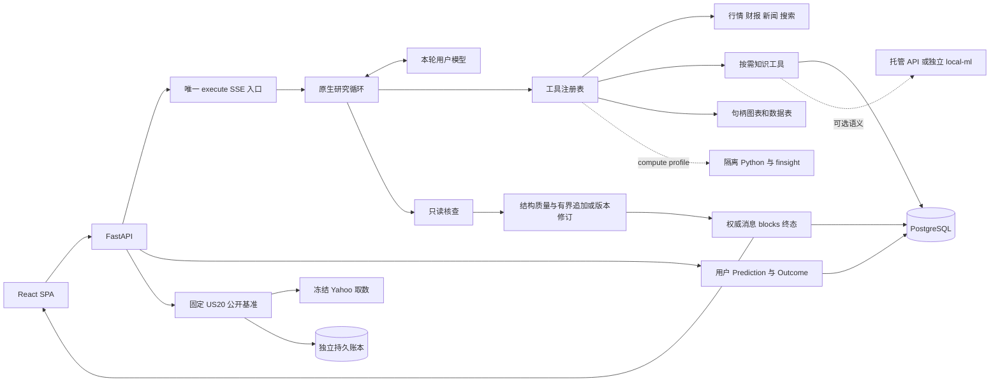
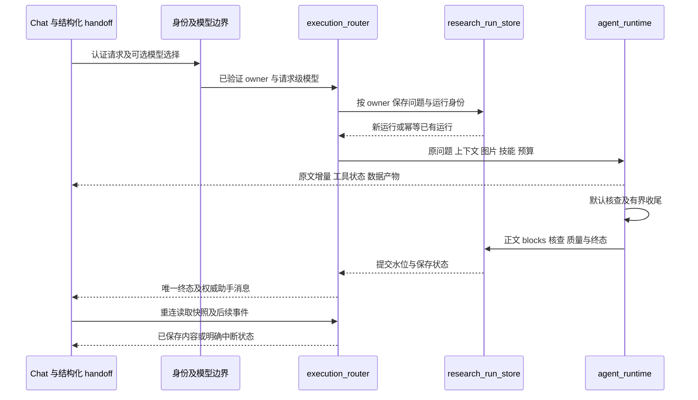

# FinSight 当前架构

文档校准：2026-11-14。本文描述当前源码的唯一原生研究架构。用户已选择 APIKL 的 `gpt-6.1-terra`，原生 tools/SSE 探针已有实际证据；完整质量对照、候选及实际部署状态统一见[运行手册](11_PRODUCTION_RUNBOOK.md)。文档更新日期不代表上线日期。

## 1. 产品与入口

主工作区为 Today、Dashboard、Chat、History；Welcome/Login、只读 Shared Report 与 TrackRecord 独立。根路径转 Today，对话和历史要求登录，Dashboard 与公开报告只展示允许的只读内容。右栏提供本次研究标的、真实走势与来源，不维护第二条执行流。

组合管理、Screener、Backtest、自动交易、独立 RAG Inspector 和工具目录不是当前产品。Ask AI 通过结构化 handoff 进入 Chat，不从展示文字恢复授权或内部状态。

## 2. 运行总览

`backend/api/execution_router.py` 只接入 `backend/agent_runtime/`。原先图、请求编译器及专项 Agent 编排不再是可选生产研究主链；退役源码位于 `tests/agent_eval/reference/`，由清单追踪并从镜像排除。27 个冻结预测依赖保留，不能把共享工具或冻结预测误当成已退役研究代码。

主要 Router 分工：

| Router | 责任 |
|---|---|
| system_router | livez、readyz、health、公开能力和 metrics |
| execution_router | Chat/Report、持久运行回放、取消、追加要求、操作确认、续研与核查修订 |
| market_router | quote/Kline/financials/news/Dashboard |
| conversation_router、watchlist_router、user_router | 已认证会话、自选与个人资料 |
| report_router | 私有报告索引/回放及受限分享 |
| predictions_router | 用户异步 Prediction/Outcome |
| prediction_router | 固定 US20 公开账本只读视图 |
| model_router、skill_router | 模型目录/连接测试及实际 Markdown 技能目录 |
| monitor_router、auth_provider_router | 页面 lease/comments 与真实登录 provider 配置 |

### 请求到交付的数据流

ticker、Dashboard 上下文和 history 是研究输入，不能覆盖资源归属或授权。同 owner/run 的重复请求复用既有运行；改变请求指纹会冲突，主动重做使用新 run。网络重连读取内容和水位，不能重新触发取数或模型计费。

## 3. 原生 runtime 边界

`service.py` 组装本轮模型、RunContext、EventSink 和存储依赖，只保留完成、取消、失败三个出口。`loop.py` 运行主研究员和专业角色，模型工具调用与结果回传使用统一 transcript；不按问法固定规划、不注入合成调用、不在循环中清洗正文。

`registry.py` 读取实际工具 schema，校验参数、角色、句柄与选择范围；`envelope.py/adapters/` 统一 status/kind/data/sources/as_of/notes/error，按 kind 渲染给模型与 UI。金融空结果、供应商失败与普通文档里的错误词分开。

`profiles.py` 声明 Price、Technical、Fundamental、News、Macro、Risk、Deep Search 角色。主研究员用 spawn_agents 并行分工，所有角色共享本轮资料、token 预留和配额；专业角色不能再委派。技能从 `skills/*.md` 读取，系统提示词提供目录，load_skill 只返回方法，不增加工具权限。

`data.py` 保存未改写的原始资料、衍生计算和来源关系。来源首次出现分配整数编号；`citations.py` 仅解析编号并查账本。read_data 分页回读真实记录，render_chart/render_table 直接引用数据字段。共享数据不等于跨 owner 共享，旧记录恢复保持原 TTL。

`compactor.py` 保留系统/用户消息和近期轮次，完整旧工具轮次可改为可回读存根或研究笔记。预算估算使用本地 tokenizer 并加余量，计费使用供应商 usage，不能将 UTF-8 字节数当作实际 token。

| 边界 | 当前实现与输入输出 |
|---|---|
| 模型传输 | `model.py`：原生正文流、工具片段和 usage；能力探针与真实运行分别记录 |
| 模型选择 | `config.py/model_options.py`：请求选择、研究专属配置、系统默认；公开 metadata 不含凭据 |
| 研究方法 | `skills.py` 与 Markdown 技能：方法可读取，schema、权限与预算由代码控制 |
| 工具执行 | `registry.py`：模型参数进入实际 schema；结构错误返回工具错误，不猜自然语言意图 |
| 数值与出处 | `data.py/analysis.py`：原始句柄、衍生关系、真实图表与表格 |
| 运行资源 | `limits.py`、RunContext：活动 run、供应商账号配额和整轮预算；换角色不重置额度 |
| 交付 | `events.py/finalize.py`：正文、核查、版本、质量及保存状态各自独立 |

## 4. 核查、补交与发布

`verifier.py` 在同一循环上创建只读核查运行：输入原问题、原答案、实际数据索引/来源/产物，只允许 read_data、run_python、submit_review，最多 4 轮和 90 秒。默认父模型，显式换模型仍共享 owner、数据、预算、取消与用量。Review/Finding/Coverage 禁止额外字段，quote 必须逐字存在；坏提交/超时返回 unavailable，核查推理不公开。

`finalize.py` 对数据回答默认核查、对报告必核查，提前保留一部分原运行预算用于收尾。answer.completed 先让正文可读，review.* 独立更新。chat findings 只标注，用户显式 review_revision 新开一轮修订；coverage 缺交付可以追加一次。报告可自动修订一次，以新 content.revised 块保留 revision_of/review_id 和原文，再核查。

质量来自引用解析、工具错误、核查及循环是否完整结束。报告需最终 pass 且无 findings/未交付项，引用有效且收尾完整，才进入默认索引；否则保留草稿。已经显示的正文不被规则删除或模板替换。终态持久化成功才返回 saved，完整字段见[事件合同](execution-event-contract.md)。

## 5. 计算与真实数据

行情网关规范化 quote/Kline/news/financials，保留 provider、源时间、抓取时间、币种及质量。日收盘不是即时行情，未知复权/股息/延迟不补成确定值。财务事实入口按发行人、指标、真实财期、频率与单位取值；累计与单季、财报时间与发布时间分开。

开放代码只进入 `backend/analysis_worker/` 的独立 dispatcher/job，无网络和宿主凭据；未配置或资源不足明确不可用。环境提供 datasets、frames、get_frame、pd、np、finsight；后者提供回撤、连续下跌、均线、统计、共同基准比较。result 是计算交付，日志不能代替结果。DataFrame 按 records 传输，不包含索引；有意义的索引应先 reset_index。有限数值和 1 MiB 上限保持。数值和计算元数据从数据记录进入 artifact，不由模型任意 JS 绘制。

研究使用共享金融工具并保留真实市场口径。固定 US20 的 Yahoo 单源、时限、模型和输入合同不随研究扩面改变；不要把用户多标的研究与公开固定评估合并统计。

## 6. 存储与认证

| 内容 | 事实源与范围 |
|---|---|
| 会话、权威消息、研究 blocks/checkpoint/终态、报告、自选 | PostgreSQL，按 owner/session/run/message 隔离 |
| 用户 Prediction/Outcome、用量与归档、Monitor | PostgreSQL，各自业务合同 |
| RAG 原文/片段/向量/观测 | PostgreSQL + pgvector，实际 embedding_identity 与权限过滤 |
| 短期研究原始资料 | FINSIGHT_ARTIFACT_DIR 文件目录，逐记录 TTL |
| 操作收据与额度租约 | FINSIGHT_ACTION_STORE / FINSIGHT_RUNTIME_QUOTA_DB SQLite |
| 固定 US20 公开评估账本 | 独立 prediction_ledger.db 与 watchdog 投递记录 |

PostgreSQL schema 由 Alembic 管理，应用启动只验证 revision。M4 的 review/revision 字段存入既有消息 JSON，不新增表。文件/SQLite 辅助状态不替代业务 PostgreSQL。

资源 owner 只来自已验证 Supabase 身份。模型配置、自选确认、续研、知识票据、报告与运行重放分别校验范围；客户端不能用 session 或上下文覆盖 owner。共享报告使用明确字段投影，私有思考和凭据不进入公开响应。

当前仍是单 API 进程/副本。正在运行的 task、取消/追加路由、scheduler 和近期事件缓冲在进程内；扩大副本之前必须设计共享 limits/actions/prediction_store 和任务路由，不能仅增加 workers。

### 状态与故障传播

| 事实 | 用户结果 | 恢复边界 |
|---|---|---|
| 金融工具空或失败 | 保留其他证据，暴露缺口或质量原因 | 不把空值写成零，不伪装完成工具 |
| 原生工具能力不支持 | 研究准入拒绝 | 重新选择经过探针验证的模型 |
| 模型或整轮预算耗尽 | 保留已有部分答复与原因 | 不延长截止时间或隐式换端点拼接正文 |
| 核查未完成 | 原答案可读，核查标为不可用 | 不当作核查通过 |
| 消息事务未保存 | 保留当前预览，明确保存失败 | 不承诺进程重启后的恢复 |
| 活动进程失联 | 租约过期后标记 interrupted | 返回已提交快照，不重跑付费任务 |
| 用户取消 | 模型、工具、专业任务和核查共用取消信号 | 旧网络事件不能复活新消息 |

## 7. 前端合同

原生 text/reasoning/artifact/action/review 块与真实工具活动按 seq 展示。progress 不进普通正文复制，核查标注不改正文，报告旧版可展开。用户修订的 review_revision 关系在本地请求快照、done 和云端消息恢复中保持；正文首尾空格保留以支持逐字 quote 定位。

图表和表格从服务端数据产物生成。正文 Markdown 中出现工具名、图表标记或代码不触发工具执行；无 blocks 的历史消息保留展示兼容，新 runtime 不经过历史补图改写。

固定文案集中 zh.ts，工具名/错误码只在诊断详情中出现。用户可见的“已核查”“资料不足以核实”和“核查未完成”对应不同结构状态。深浅主题和涨跌配色不改变成功/失败语义；样式以 DESIGN 与现有 CSS/token 为准。

## 8. 模型与部署边界

研究模型使用当前请求选择，其次研究专属配置，最后系统默认。Step Plan 与独立 Step 5 按量目录项分开，后者使用 FINSIGHT_AGENT_STEPFUN_API_KEY，1M 上下文与 16384 运行输出预算；不改变冻结预测默认。自带模型凭据只在当前页面/请求内存中，核查与专业角色不回退到其他用户配置。

默认 Compose 运行 PostgreSQL、API 和前端；compute 与 local-ml 为显式可选 profile。API 镜像不安装本地重型推理库，不在 QA 子进程另开 BGE 副本。RAG 默认词法，可选独立托管 embedding/rerank 或私网 local-ml；相同维数不代表相同向量身份，语义不可用时明确词法降级。

本轮已确认的生产服务仍是旧 backend、frontend、watchdog 与计算镜像组合。最新源码候选已在本机完成依赖、冻结预测文件和镜像核验；早期候选有远端预验证记录，但在后续代码变更后已过时，不能用于切换。当前源码对应的正式质量对照、发布清单及部署后验收状态集中在运行手册。服务 healthy 与新模型探针均不能替代完整研究质量、认证浏览器和发布后验收。

完整质量对比、核查检出/误报、48 项验收、真实登录与部署观察分别留证。旧图仅保留[历史定位](archive/2026-11-13_documentation_refresh/LANGGRAPH_FLOW.md)，新功能不能恢复其生产路由。发布、迁移、备份和回滚统一见[生产运行手册](11_PRODUCTION_RUNBOOK.md)；研究、检索、数值与事件细节分别见 [Agent 指南](AGENTS_GUIDE.md)、[RAG 架构](05_RAG_ARCHITECTURE.md)、[图表合同](REPORT_CHART_SPEC.md)和[事件合同](execution-event-contract.md)。
