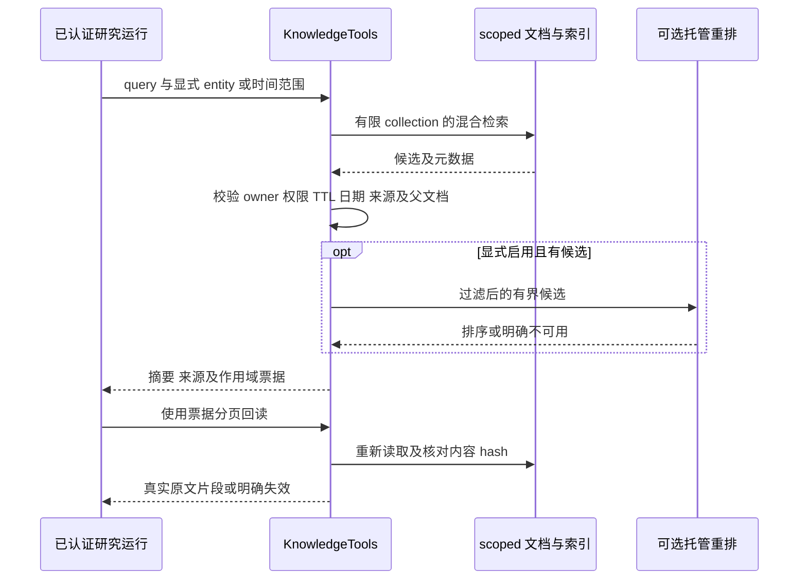

# FinSight RAG 架构

当前接线校准：2026-11-13。本文以当前 `backend/rag/` 和原生工具注册表为准，区分源码默认、显式托管配置和实际索引状态。新候选尚未部署；本轮聊天模型切换不修改 RAG 模型、向量身份或既有知识库。历史真实检索和迁移结果保留在[原实施记录](reports/2026-11-07_agent_runtime_implementation.md)，不能代替当前评估。

## 1. 默认运行与可选语义能力

- 存储保留 PostgreSQL/pgvector 和 memory、working set、knowledge base 三层语义。
- 默认 RAG_EMBEDDING=lexical、RAG_RERANKER=none，不加载或下载本地模型。
- 托管模型选择 remote_api；自建 BGE worker 仅由 local-ml Compose profile 显式启用。
- backend/rag/tools.py 提供按需 search_knowledge、read_document、search_memory。作用域由认证运行时创建，模型不能传 owner 或任意 collection。
- 原生 registry 的 search_memory 组合当前用户的知识检索与会话轻记忆，read_data 回读授权票据；旧 execution_pipeline 仅作历史评测参考，不是生产兼容入口。不要求每轮把工具结果向量化后重新检索。
- 普通追问复用同owner/session已取得且逐记录TTL仍有效的原始资料，不因新run续期；供应商思考与核查内部推理不写入知识库或金融证据。
- 观测记录真实发生的摄取/检索；不为生成观测指标额外执行模型。

~~~mermaid
flowchart LR
    QUERY[原生 registry 按需查询] --> TOOLS[KnowledgeTools / owner与session]
    TOOLS --> LEX[词法检索]
    TOOLS -->|按配置| API[托管 embedding API]
    API --> ID[模型 / 代次 / 维度身份]
    ID --> DENSE[同身份向量检索]
    LEX --> PG[(PostgreSQL / pgvector)]
    DENSE --> PG
    DOC[值得保留的文档] --> INGEST[独立摄取/去重]
    INGEST --> PG
    INGEST -->|可选| API
    PG --> FILTER[权限 / TTL / 日期 / 实体过滤]
    FILTER --> CAND[有界候选]
    CAND -->|可选| RERANK[托管重排 / 最多32候选]
    CAND --> HIT[来源 / 时间 / 层 / 回读票据]
    RERANK --> HIT
    HIT --> TOOLS
    TOOLS -. 显式local-ml .-> LOCAL[可选私网BGE worker]
    LOCAL --> ID
~~~

## 2. 三层与访问边界

| 层 | 目的 | 生命周期 |
|---|---|---|
| memory | 当前用户/线程的轻上下文，不存大原文 | 与认证 owner/thread 绑定 |
| working set | 当前任务已取得的资料 | 短期、与 run/thread 绑定 |
| knowledge base | 可重复使用的公开文档或显式授权资料 | 长期、带来源和版本 |

KnowledgeTools 在构造时接受服务器提供的 owner/session/allowed_collections；模型工具参数不包含这些授权字段。每个运行只创建一次实例，向量服务延迟到实际查询才初始化。

- 当前会话的 ws/mem 可读；显式授权 collection 由服务器负责校验。
- 共享 KB 中的资料必须有 visibility=public 或位于服务器授予的 collection；出现其他 owner/user_id 时拒绝。
- 没有公开分类的旧 KB 不能只因 kb 前缀就被跨用户读取。
- 搜索颁发当前作用域的 document_id。read_document 只接受已颁发引用，并再次验证过期、权限和内容 hash。
- 文档更新后旧引用失效，要求重新检索，不把新内容冒充旧证据。
- search_memory 可以读取当前运行传入的轻记忆快照；密钥、token、密码字段不进入输出。
- 所有返回正文标记为不可信来源数据，不能成为工具指令或用户授权。

### 存储层与运行时资料的分工

| 内容 | 入口与用途 | 访问约束 |
|---|---|---|
| 会话轻记忆 | `build_thread_memory_collection`、`KnowledgeTools.search_memory` | 当前 owner/session；敏感字段不进入模型投影 |
| 当前任务 working set | `build_thread_working_set_collection`、`hybrid_search_many` | 按线程/任务范围与元数据再校验 |
| 标的或宏观 KB | `build_stock_kb_collection`、显式 entity | 公开标记、当前 owner 或服务器明确授权 |
| 原生运行的工具原文 | `RunData.record/read/save/restore` | 同 owner/session、原记录 TTL；不要求先入向量库 |
| 知识回读票据 | `KnowledgeTools._ticket/read_document` | 绑定 owner/session、collection、source 与内容 hash |

collection 命名提供分层语义，不能代替权限。相同股票的知识也可能属于不同用户；旧 KB 缺少可证明的 owner 或公开标记时拒绝跨用户读取。当前线程已获取资料优先按句柄复用，持久知识仅在模型需要时检索。

检索参数只允许 query、entity、limit、time_range 和 sources 等有限机器字段；不接受模型传来的任意 owner/collection。搜索过滤与原文回读都检查范围，票据不是永久授权。不同运行恢复资料时不刷新旧 TTL。

## 3. 托管 API 配置

接口使用 OpenAI 风格 embeddings JSON；重排使用独立的 query/documents/results 协议，不假设聊天接口具备这两项能力。API URL 是完整端点，禁止重定向转发凭据。

### SiliconFlow 免费模型候选

2026-11-06 核对的 [官方价格页](https://www.siliconflow.cn/pricing) 将 BAAI/bge-m3 和 BAAI/bge-reranker-v2-m3 标为免费。免费模型仍需要单独的 SiliconFlow 账户/API Key，并受平台实际配额与可用性约束；价格与规则可能变化。

不把其他域名的聊天密钥发送给 SiliconFlow。2026-11-07 历史生产记录使用独立托管embedding/重排安全配置，并完成下方限定范围的真实验收；当前部署需重新核对，不把“价格标免费”当成质量、无限配额或永久免费的承诺。

可采用如下服务端配置，密钥仅由安全环境注入：

~~~dotenv
RAG_EMBEDDING=remote_api
RAG_EMBEDDING_API_URL=https://api.siliconflow.cn/v1/embeddings
RAG_EMBEDDING_MODEL=BAAI/bge-m3
RAG_EMBEDDING_DIM=1024
RAG_EMBEDDING_MODEL_VERSION=siliconflow-bge-m3-generation-1
RAG_EMBEDDING_BATCH_SIZE=8
RAG_EMBEDDING_TIMEOUT_SECONDS=20
# RAG_EMBEDDING_API_KEY 由安全配置提供，不在版本库填写。
RAG_RERANKER=none
~~~

重排仅在检索评估显示有收益时启用：

~~~dotenv
RAG_RERANKER=remote_api
RAG_RERANK_API_URL=https://api.siliconflow.cn/v1/rerank
RAG_RERANK_MODEL=BAAI/bge-reranker-v2-m3
RAG_RERANK_TIMEOUT_SECONDS=15
# RAG_RERANK_API_KEY 单独由安全配置提供。
~~~

没有配置 embedding API Key 时，remote_api 调用返回明确配置错误，知识库仍可词法读取；不会偷偷转本地模型或 hash。

API 适配验证返回数目、index唯一性/顺序、维度、有限非零向量及模型名；跨批次 revision 变化会被拒绝。请求/响应有大小和超时边界，继承当前 RunContext 截止时间，错误不会回显供应商正文或密钥。

重排在权限/时效/来源过滤后最多外发32个候选，记录实际rerank_used/score；失败保留原检索顺序并披露。不应盲目更改既有模型代次：新identity不自动匹配旧向量，上方配置例是接入模板，现有部署须沿用经过核验的实际身份。

## 4. 摄取、向量身份与词法检索

摄取保存原文、source/title/URI、日期、作用域和内容 hash。推理不可用时向量为 NULL；同一原文更新时保留旧向量及身份，不凭维度猜测其模型。

EmbeddingResult 的 model_name/model_version/dim 经 embedding_identity 进入 metadata。托管身份还区分 endpoint、显式代次和编码方式；供应商返回 revision 时纳入身份。未返回 revision 时使用配置代次，这不能证明供应商永远不改变同名模型；供应商模型变更需主动提升代次并重建。

Dense 查询只匹配相同 identity。词法查询使用中英文词元，中文采用轻量二元组；原文不变。新摄取写入词法预处理文本，旧中文记录仍可在限定 collection 内用精确包含匹配兜底，不执行全库无范围扫描。

现有 reindex_pending 是**原位覆盖**，本身不保留旧向量。模型切换前验证备份/回滚与离线重算窗口，或建立可同步变更的影子代次；只改endpoint不等于数据回滚。前阶段已在副本生成真向量并提交生产守卫迁移：保留原文和权限/时间，仅更新白名单索引字段、新增无损片段并重建向量索引。新严格设计发布不再次运行该迁移。

长原文与索引单元分开：原文全文可用票据分页回读，父原文向量为空，片段最大6000 UTF-8字节，能无损重组。来源展示仅保存有界metadata/data_ref，不把完整行情大表复制到每条引用。原文hash/owner/父子关系或片段内容变动须整批拒绝，回滚包保留原文/旧向量守卫，不能覆盖发布后的无关写入。

### 索引更新与回滚

改 embedding 模型、版本或编码配置时，先盘点原文、片段、权限、TTL 和现有 identity，再选择可恢复的离线重算或影子代次。备份需要包含旧向量及其身份，只有源代码回滚不能恢复被原位覆盖的向量。

验证至少覆盖：原文 hash 未变、父子片段可无损重组、权限/时点未改变、不同身份不进入 Dense、未完成索引仍可词法查询。切换后只更新已核对的索引字段；回滚不能覆盖发布后的无关业务写入。模型或聊天密钥替换不触发自动重索引。

## 5. 默认镜像与可选 worker

| 文件 | 用途 |
|---|---|
| requirements-runtime.txt | API/金融工具/研究运行依赖 |
| requirements.txt | 兼容入口，仅包含 runtime |
| requirements-dev.txt | runtime 与测试依赖 |
| requirements-eval.txt | 离线评估/RAGAS |
| requirements-local-ml.txt | 显式本地向量依赖 |
| Dockerfile | 默认API镜像，不安装本地ML库 |
| Dockerfile.rag | 可选BGE推理镜像，包含CPU Torch |

Compose 默认不运行 rag-inference，API 不挂 model_cache。需要自建模型时启用 local-ml profile，同时明确配置 RAG_EMBEDDING=bge-m3、RAG_WORKER_URL=http://rag-inference:8010 和 RAG_WORKER_TOKEN。

私网 worker 仍保留令牌校验、批次限制、推理锁、实际模型 revision、宿主/cgroup 内存检查及资源上限；缺 token 时启动失败。worker不公开宿主端口，模型缓存仅挂在该可选服务。

默认运行依赖和 API 镜像排除 Torch、Transformers、sentence-transformers、FlagEmbedding、chromadb 与 ragas；重型本地推理和评估各用独立 requirements。镜像能导入不等于模型推理可用；启用 local-ml 前必须验证真实 worker、身份和资源峰值，不能在额外 QA 进程加载同一组模型来凑验收。

## 6. 就绪与真实能力

- 生产词法模式要求 PostgreSQL/索引可读；不为健康检查加载模型。
- 托管模式以实际检索最近取得的向量身份报告 semantic_ready。尚未真正调用时为 unverified，仍可明确提供词法能力。
- 健康端点不额外请求托管模型消耗额度。
- 可选 worker 的健康信息仍来自实际推理与 revision；模块能导入不代表模型可用。
- none 重排是主动关闭，不应阻止服务就绪。
- ready=true 不等于语义索引覆盖全部文档；index.pending 与 full_ready 单独报告。

| 观察 | 正确解释 |
|---|---|
| lexical_ready=true | 受限范围内的持久词法读取可用 |
| semantic_ready=true | 当前检索使用过可验证的向量模型身份 |
| pending 大于零或 full_ready=false | 索引覆盖未完成，不能宣称全部知识可语义检索 |
| remote_api 尚未真实调用 | 语义能力未验证，不能仅凭配置标为成功 |
| local-ml resource_limited | 资源保护生效；本地推理未验证 |
| PostgreSQL 生产连接不可用 | readiness 失败，不能用内存库冒充持久服务 |

## 7. 验证入口

当前聚焦测试：

- backend/tests/test_knowledge_api_tools.py：托管响应、失败/重定向、身份、知识作用域、过期与更新、中文词法、健康。
- backend/tests/test_rag_worker_contract.py：worker、资源保护、真实模型身份、词法降级与回填。
- backend/tests/test_rag_v2_service.py：现有存储、排序与维度合同。
- backend/tests/test_health_and_validation.py：服务就绪语义。

2026-11-07 已完成的历史真实证据（保留原范围和结果，不代表新运行时验收）：

| 验证 | 结果与限制 |
|---|---|
| 托管embedding/重排+pgvector | 21条合成金融/隔离语料，8条中英文标注查询；混合Recall@3=.5000/nDCG@3=.4759，真实重排后均1。只证明这些查询，不外推全站质量 |
| 长文 | 36,454字符原文无损回读；存量16片段+新摄取3片段共19真1024维向量，最大5984字节，父原文无向量 |
| 副本与生产迁移 | 原2409记录、76长文、新增363无损片段；active2304、索引单元2228全部semantic_ready/pending0。副本守卫与真实生产事务分别验收 |
| 生产存量烟测 | 8语义hit、3重排、原文回读一致，0.686秒；无生产测试文档插入，不是生产规模压力测试 |
| 回滚 | 真实PG TEMP目标恢复2409原记录、只删363迁移片段，保留无关新增且幂等；验证事务回滚，生产整套回滚未执行 |

证据为本地`.omx/live-vector/`、`.omx/rag-migration/`、生产存量烟测与[实施记录](reports/2026-11-07_agent_runtime_implementation.md)。最终`design-production-check.json`确认新发布RAG full_ready/2228 semantic_ready/pending0；观察期仍待补，不以mock或旧probe替代。评估规范见 [rag-evaluation-guide.md](rag-evaluation-guide.md)。
