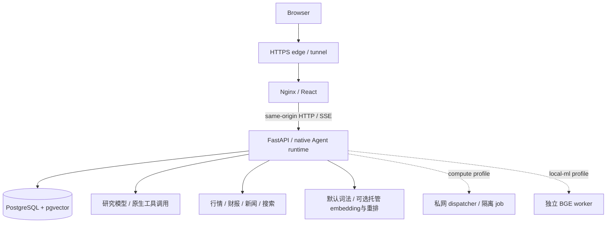
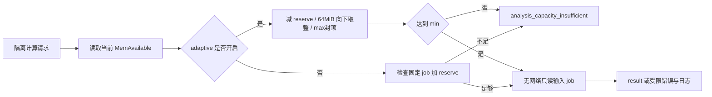

# FinSight 生产发布 Runbook

更新时间：2026-11-07（主应用新修复待 after/发布；独立 compute 已更新）

本文是当前唯一生产运维规范。最近已确认主应用为后端 `agent-20261107-8b809bee23e0`、前端 `ui-20261107-9cfdc5be5e05`，原发布证据保留在[实施记录](reports/2026-11-07_agent_runtime_implementation.md)。独立 compute `python-20261107-a0b8e1d70e82` 已部署且 healthy，主后端未重启；本次主应用的过程/答案和数据检查修复仍待 after 验收及新发布，见[本次记录](reports/2026-11-07_natural_response_compute/README.md)。

## 1. 发布不变量



- 会话、权威消息、研究 checkpoint/终态、Watchlist、报告、用户 Prediction/Outcome 的业务事实源是 PostgreSQL；schema 由 Alembic 管理，应用启动不执行 DDL。
- 生产必须启用 Supabase 认证；Chat、History、Prediction、Watchlist、Monitor 和私有报告不得通过伪造 owner 或匿名写入绕过鉴权。
- 默认 `FINSIGHT_RESEARCH_RUNTIME=agent`。主研究员和专业角色共用原生工具循环、所选模型、预算与资料合同；只有主研究员可委托任务，不嵌套派发。原确定性 Collector 和六节点图仅适用于显式 legacy 路径。
- 本轮授权默认供应商 reasoning 展示，并将单 run 含子 Agent 最多 20,000 字符保存到 owner 所属消息/checkpoint，历史可展开；不进入金融证据、引用、普通正文、公开报告或日志。没有真实字段不编造，旧 opt-in/仅页面内存策略已替代。
- 工具 display 逐项注册，seq 穿插正文与活动；7 项真实 manifest 可由用户 `/` 菜单及主/专业 Agent `use_skill` 加载，技能不扩权或改预算。普通追问继承同会话有效资料且逐记录 TTL 不续期，不添加常驻继续 CTA。
- `progress` 只作过程说明，最终 `answer/response` 用于正文、复制、摘要和后续回答历史；最多一次禁工具修正共享原预算。删除旧候选不生成成批撤回占位，但真实失败和质量缺口仍须保留。
- 固定 US20 Technical/Risk forecast、公开账本及独立 watchdog 与用户研究分开；不修改冻结预测算法、模型配置、采集预算或统计口径。公开账本文件继续保存在 backend_data 持久卷中。
- Prediction 只接收可信 provider 的真实 K 线；错误、缺失和日收盘数据必须保留来源、时间与口径，不生成替代行情或假预测。
- 原生短期资料、额度租约和操作收据位于持久目录；文件/SQLite 辅助存储不替代业务 PostgreSQL。不能把这些文件或公开预测账本当作过时垃圾删除。
- `.env.server`、JWT、key、Cookie、DSN 只通过安全配置或环境引用，不进入源码包、镜像、构建日志、截图或发布证据。配置校验只记录存在/匹配布尔值。
- `/livez` 只表示进程存活；`/readyz` 是健康发布及回滚的就绪门禁，`/health` 保留兼容摘要。HTTP 200 前端、容器 running 或无 OOM 不能代替完整就绪。
- 默认同源 API/SSE 由 Nginx 代理；只在实际维护独立 API origin 时设置 `VITE_API_BASE_URL`。
- 运行终态和已提交 blocks 可恢复，最终消息事务提交后才交付保存成功；旧快照不得覆盖权威正文，同 run 恢复不得重新付费执行。
- 当前只运行一个 backend 副本。执行 task、追加要求/取消路由、scheduler 和近期事件缓冲仍在 Web 进程内，不声明多机任务调度。
- API、QA 和发布检查不加载本地 ML 模型；托管模型按 API 调用，local-ml 只在显式启用的独立 worker 推理。
- quality blocked 报告不进入默认索引或分享；共享报告仅投影 allowlist，使用 `private, no-store`。
- 公开只读行情 GET 仍受限流；探针不进入普通流量桶。模型/供应商错误须脱敏并保留稳定失败码。

## 2. 配置与运行模式

以 `.env.server.example` 和实际 Compose 为配置模板；复制并合并安全配置，不用部分配置覆盖数据库、认证、行情与预测字段。部署前只核对值是否存在、是否匹配，不打印内容。

| 范围 | 配置与边界 |
|---|---|
| 生产身份 | `APP_MODE=production`、`SUPABASE_AUTH_REQUIRED=true`；Supabase URL/公开配置与前端匹配，认证域名和 verifier 实际可用 |
| 核心数据库 | `FINSIGHT_POSTGRES_DSN` 与 PostgreSQL 用户/库配置；实际 migration head 匹配镜像，生产不使用内存存储 fallback |
| 原生研究 | `FINSIGHT_RESEARCH_RUNTIME=agent`、`FINSIGHT_AGENT_API_BASE/MODEL/API_KEY`；模型通过真实原生工具预检，用户显式选择不静默改用系统模型 |
| 预算与并发 | `FINSIGHT_AGENT_TOKEN_BUDGET/MAX_TURNS/MAX_ACTIVE_RUNS/MODEL_CONCURRENCY` 和 provider RPM/TPM 按实际额度配置；保留独立预测容量 |
| 持久辅助目录 | `FINSIGHT_ARTIFACT_DIR`、`FINSIGHT_ACTION_STORE`、`FINSIGHT_RUNTIME_QUOTA_DB` 位于 backend_data；owner/session/run 与过期边界不变 |
| RAG 存储 | `RAG_V2_BACKEND=postgres`、`RAG_V2_ALLOW_MEMORY_FALLBACK=false`；生产文档、索引状态、向量 identity 一致 |
| Checkpointer | 生产 PostgreSQL checkpointer 与持久 DSN；原生 checkpoint 保存于权威消息 JSON，不新建运行时表 |
| Prediction/Monitor | 保留已授权开关、可信 K 线 provider、原模型及 Outcome/Monitor 配置；不因研究模型切换开启 US20 采集或发送测试告警 |
| 可选图片 | 只对实际验证图片输入的模型启用 `FINSIGHT_AGENT_VISION`；当前轮 PNG 不进入普通历史或原始资料缓存 |
| 新研究节流 | 新发布核对 `FINSIGHT_AGENT_MIN_REQUEST_INTERVAL_SECONDS` 和实际 provider 额度；首增量前 429 有界退避与结构修复共享截止时间，不重复启动业务工具 |
| 隔离计算额度 | `FINSIGHT_ANALYSIS_ADAPTIVE_MEMORY`、`FINSIGHT_ANALYSIS_MIN_JOB_MEMORY_MB`、`FINSIGHT_ANALYSIS_JOB_MEMORY_MB`、`FINSIGHT_ANALYSIS_MEMORY_RESERVE_MB`；实际启用值与容量字段分别核对 |
| MCP | 默认关闭；启用时仍要求可信 principal 与资源 owner 校验 |

### RAG 的三种模式

1. 默认 `RAG_EMBEDDING=lexical`、`RAG_RERANKER=none`：不拉取模型、不启动 `rag-inference`。
2. 托管模型：显式 `RAG_EMBEDDING=remote_api`，配置独立 embedding URL/model/key/dimension；重排需 `RAG_RERANKER=remote_api` 和独立 URL/model/key。当前生产使用 SiliconFlow BGE-M3 1024 维与 BGE reranker。identity/维数不匹配、配置或调用失败必须明确降级，不把 hash 或旧未知身份标为真实 BGE。
3. 本地模型：仅在已验证物理内存足够并显式选择 `local-ml` profile 时启用独立 `Dockerfile.rag` worker，配置 URL/token。该模式不是默认发布依赖；目前生产停用，本地 BGE 缓存已清理，再启用需重新下载并实际编码验收。

本地 worker 原有 3000 MiB 内存、3600 MiB 内存加 swap、1 CPU、128 PID 与至少 2400 MiB 可用物理内存保护仍适用。不能调低保护或借 swap 冒充模型容量。托管模式无需启动本地模型；真实语义与 rerank 是否可用以实际请求、提交向量和回读证明。

### 可选计算

`compute` profile 单独提供 job 镜像与 dispatcher；job 镜像只用于每次独立作业，不是常驻研究进程。配置 `FINSIGHT_ANALYSIS_WORKER_URL/TOKEN`，dispatcher 调度 Docker 权限不交给 API、模型代码或 job。作业无网络/主服务凭据/socket，输入只读，临时目录与进程隔离，资源受限；超时或取消清理所属容器和输入卷。未配置或资源不足时明确不可用，禁止回退到 Web 进程执行开放代码。

未配置时，代码和 Compose 默认仍要求固定 512 MiB job + 256 MiB 物理内存保留，adaptive 为 false。每次任务重新读取可用内存，不借历史快照判断当前容量；dispatcher healthy 不代表任务可执行。

本次低内存配置明确设置如下；文档示例不是自动修改生产配置的命令：

```dotenv
FINSIGHT_ANALYSIS_ADAPTIVE_MEMORY=true
FINSIGHT_ANALYSIS_MIN_JOB_MEMORY_MB=128
FINSIGHT_ANALYSIS_JOB_MEMORY_MB=256
FINSIGHT_ANALYSIS_MEMORY_RESERVE_MB=128
```

adaptive 作业额度为 `min(max_job, floor((MemAvailable - reserve) / 64) * 64)` MiB，低于 min 时拒绝。该配置下可用物理内存 256–319 MiB 选 128 MiB、320–383 MiB 选 192 MiB、至少 384 MiB 选 256 MiB；低于 256 MiB 拒绝。每次提交重新测量，不把 swap 算入，也不是 OOM 后自动重复运行的升级策略。job 的 `--memory` 与 `--memory-swap` 相同。



compute `/health` 分别报告 `ready/error/available_memory_mb/job_memory_mb/can_accept_job/min_job_memory_mb/max_job_memory_mb/memory_reserve_mb/adaptive_memory`。先确认镜像与配置，再检查能否接收任务；HTTP 200 或 ready=true 不替代一次真实成功作业。独立计算更新不表示 Web 后端已切换新的提示、结果适配或声明检查逻辑。

作业输入最大 4 MiB、代码最大 16000 字符、结果最大 1 MiB、最长 60 秒。`stdout/stderr` 合并为最多 16 KiB 的 `logs`，超出带 `logs_truncated=true`；`code_error` 只包含受限异常类型、最多 500 字符的消息和可得的代码行号，不传完整宿主堆栈。日志仅为诊断，不作为金融结果或公开报告资料。

`datasets` 保留授权原始包，环境预置 `pd/np/get_frame`。`get_frame(data_ref)`、`get_frame(datasets[data_ref])` 或显式行列表可生成 DataFrame；具名表使用实际 `table` 键，必要时先从原包选择正确层级。SEC 平行数组包额外支持 `table="companyfacts"`，与 inspect 暴露的表名一致；财期/指标数组仍需等长。

对于 SEC 平行数组，DataFrame 保留原 `period_ends/periods` 列，增加 `period_end/period` 别名；没有 periods 时 period 使用原 period_ends。原包中已有且为标量的 `ticker/market/source/source_url/as_of/currency/frequency` 也保留为上下文列，不填造缺失字段。多表不猜选、文本或未知结构不强行造表；该入口不自动排序、换单位或补缺值，原始 datasets 不变。

需要返回的结果必须赋给 `result`；只 print 返回 `analysis_result_missing`，应查看日志并修改代码后再按剩余预算尝试。编码器将 NumPy 标量经 `item()` 转为原生值、将 `pd.Timestamp` 转为 ISO 时间字符串，再形成原生 JSON 结果；DataFrame/数组仍应显式转为 rows/列表。严格 JSON、1 MiB 结果及日志上限不变，NaN/Infinity、超大结果或错误 shape 仍拒绝，不自动补零或静默改为空值。给 `render_chart` 的表格建议为 `{"rows": [...], "summary": "..."}`，多表明确选择。容量不足、OOM、超时、代码错误和日志应分开记录。

`python-20261107-a0b8e1d70e82` 已独立部署 healthy；本机、真实 Docker、生产任务和主应用联调各自保留验证范围与结果，见[本次复验](reports/2026-11-07_natural_response_compute/README.md)。实际分配额度和任务成功不能仅由健康状态推断。

该版本已有原失败代码/原 SEC 数据不变的生产重放证据：两段小作业都在 256 MiB 分配、128 MiB 保留下返回正确季度收入差额及变化率，见[受限验证记录](reports/2026-11-07_natural_response_compute/production-sec-replay.json)。这证明相同输入的数据适配与计算通道修复，不代表任意 Python 容量或主模型多会话答案已经通过。

### Legacy 预算与网络边界

原生与 legacy 均继承 `RunContext` 累计截止时间（研究 180 秒、报告 300 秒），原生另有工具循环/token 预留与租约。以下语义理解、结构修复和确定性超时投影专属于 legacy：理解阶段不超过 60 秒及整轮余量三分之一；纠错共享阶段截止时间，投影/终态保存的 3 秒/2 秒上限不代表原生流程拥有同一节点。

`LANGGRAPH_EXECUTE_LIVE_TOOLS`、`LANGGRAPH_SYNTHESIZE_MODE`、`FINSIGHT_STRUCTURED_SYNTHESIS` 与旧合成输出额度属于 legacy 配置，不作为原生角色或模型循环的硬合同。预测时限与冻结配置继续独立保留。

`YFINANCE_PROXY` 与 `SEARCH_PROXY` 只由各自客户端读取，不提升为进程级 `HTTP_PROXY/HTTPS_PROXY`；`NO_PROXY/no_proxy` 保持一致。US20 使用既有 `create_ticker` Yahoo 专用代理，不用直连结果替代生产预检。研究模型配置不覆盖公开预测的服务端模型或凭据。

## 3. 发布产物与本地门禁

Git 提交发布可用精确 commit SHA；用户明确授权发布未提交实现时，可使用不可变 release ID、文件 SHA-256 manifest 与镜像 ID，记录基线 SHA、未提交状态、源码范围、测试和镜像导入哈希。不得仅凭 `latest`、可变 tag 或未经核验的任意工作区发布，也不因部署擅自提交、推送或覆盖用户改动。

未提交源码发布需记录基线、runtime manifest、dirty 范围与镜像身份；前端、后端和独立服务更新分别追溯。文档 overlay 单独列出路径，不修改业务源码或 runtime manifest，不能将任一补丁描述为全部文件仍匹配旧清单。

按受影响范围执行并记录：原生工具/权限/预算/交付聚焦、legacy 兼容回归、真实 PG 事务/RLS/checkpoint、RAG 身份/过滤/长文回读、计算隔离、OpenAPI/前端类型、单测、构建及关键浏览器交互。仅导入模块、HTTP 200、mock 供应商或 `done` 字符串不足以证明真实质量。检查不能访问私有配置或把密钥写入产物。

验证分类至少包括前后端回归、真实 PostgreSQL、隔离 Docker、浏览器和真实模型任务；范围、跳过项、源码版本与结果记录在[复验报告](reports/2026-11-07_natural_response_compute/README.md)。测试数量有重叠时不相加，候选构建/export smoke 和服务器 prepared 状态不能代替正式启动或完整答案验收。

## 4. 服务器目录、预检与清理

当前 Compose 项目固定为 `finsight`，防止 release 目录变化生成新项目和空数据库卷。

| 位置 | 用途 |
|---|---|
| `/home/ubuntu/finsight-releases/<release_id>` | 已验证的独立发布快照与 Compose |
| `/home/ubuntu/finsight-current` | 当前发布软链接；操作前解析并记录实际目标 |
| `/home/ubuntu/finsight-shared` | 受限版本化安全配置、上传/部署记录和迁移/回滚交付 |
| 当前 release 的 `.env.server` | 指向 shared 内版本化安全配置的软链接，权限受限，不能随源码打包 |
| `/home/ubuntu/finsight-shared/rag-migration-20261107` | 保留的 RAG 迁移交付，不自动重跑 |
| `/home/ubuntu/finsight-shared/rag-rollback-20261107` | 保留的数据回滚交付；本地归档为 `.omx/rag-migration/rollback-package.tar.gz` |
| `/home/ubuntu/FinSight` | 历史工作区，不再假定为当前运行目录；不覆盖其未提交改动 |

每次操作先记录当前容器实际镜像、Compose labels、发布目录/软链接、持久卷、活跃研究、资源和回滚点。使用明确 `-p finsight`、release 的 `--env-file` 与 `-f docker-compose.yml`；不要输出完整 Compose 展开配置，它可能含密钥。

以下是配置校验形式，路径须来自正在操作的精确 release。文档核对不访问生产配置、不重跑启动或回滚；compute 为可选 profile，只有实际部署它时另行启用。

```bash
docker compose -p finsight \
  --env-file /home/ubuntu/finsight-releases/agent-20261107-8b809bee23e0/.env.server \
  -f /home/ubuntu/finsight-releases/agent-20261107-8b809bee23e0/docker-compose.yml \
  --profile predictions config --quiet
```

空间门禁维持根分区使用率低于 90%、可用至少 5 GiB；物理可用内存、swap 使用和其他容器占用须当次实测，不能以历史快照或未 OOM 推断容量。生产小内存主机只做少量串行烟测，完整供应商/报告/ML 验收放在开发机或独立环境。

删除/批量移动/数据库结构与恢复必须有明确授权。清理只针对确认可再生成且不再引用的 FinSight 产物，保留当前/立即回滚镜像、安全配置、审计证据、数据库卷、原文/向量回滚输入、业务资料与其他项目。禁用全局 Docker prune/volume 清空来凑空间。清理本地 ML 权重须记录重新下载成本；缓存仅按自身标记和 TTL 清理。

## 5. 数据备份与迁移

PostgreSQL 备份须在隔离临时库实际恢复并校对关键表/记录；只读目录或 `pg_restore --list` 不是恢复证明。备份、安全配置与生产数据不进入公开证据。真实 RLS 拒绝需使用非 superuser、无 BYPASSRLS 角色，跳过不能记通过。

Alembic 迁移先在隔离库验证旧 revision 到镜像 head、事务失败回滚、历史读取与兼容镜像启动。本轮 schema 为 `20261003_0006`；`0005/0006` 是保留数据的前向迁移，生产已有写入后不做 downgrade 删除。应用启动只校验 revision。

存量 RAG 变更先备份原文、metadata 与旧向量；在副本验证无损分块、权限/时间继承、过期记录不变、完整 identity、真向量与回读。生产事务按守卫 COPY/staging、白名单更新、精确片段插入、索引重建和 COMMIT 顺序执行。原文、owner、父哈希或已有片段变化须整批拒绝，不能静默覆盖并发写入。

迁移验收分别记录原始记录、父原文、可索引片段、semantic_ready 与 pending 数量；父原文不是向量单元，不能把总行数当作向量数。优先用存量文档验证生产检索，不为只读探针插入测试记录。已完成迁移的具体数量和证据保留在[原实施报告](reports/2026-11-07_agent_runtime_implementation.md)，不把旧快照当作当前计数。

下一严格设计发布不再次执行上述已提交迁移。先确认 schema、索引与回滚包仍匹配，只处理该次实际需要且已授权的变更，不因新镜像自动重跑旧数据包。

## 6. 镜像与顺序部署

镜像在发布前构建/验证/导出哈希，服务器校验并导入精确 tag。后端、前端、可选 compute job/dispatcher 与 local-ml worker 分开镜像；API 不包含 Torch/Transformers/FlagEmbedding 等本地 ML 依赖。

1. 核对 release manifest、实际镜像 ID、安全配置、Compose 项目/卷和兼容回滚点；有活跃研究时先按合同排空，不直接切走运行。
2. 如有迁移，停止会写入相关数据的本轮服务，执行经过验证的事务；失败回滚并恢复旧服务，不继续使用半迁移数据。
3. 沿用第 4 节 Compose 前缀，以 `up -d --no-build --no-deps backend` 启动新后端。该后缀已在本轮部署执行；不在小内存生产机重新构建镜像。
4. 正常健康发布必须后端直连与同源代理 `/readyz` 均通过，再依次启动前端及已授权的独立 profile 服务。当前角色与预测开关不因发布自动改变。
5. `compute` 只有明确配置/资源允许才作为可选服务启动；本轮 dispatcher 启动但资源门禁拒绝作业。默认不执行任何启动 `rag-inference` 的命令。
6. 检查运行镜像 ID、前端 `app-version.json`、当前软链接与 release 对应；记录 probe、迁移和 canary 状态。

`prediction-watchdog` 仅按既有公开账本授权使用 `predictions` profile；保留 ledger/watchdog 文件。不能为了启动新研究开 US20 采集、补写历史预测或发送测试告警。

前端可独立设置FRONTEND_IMAGE_TAG，保留后端IMAGE_TAG与运行镜像。当前后端agent-20261107-8b809bee23e0、前端ui-20261107-9cfdc5be5e05；补丁仅修无可信终态时不伪造历史耗时，17项单测通过且backend_restarted=false。分别核对主/补丁manifest，不由一端推断另一端。

## 7. 真实 canary 与交付验收

必须区分公开只读、服务器内部、开发 fixtures 与真实登录用户检查。真实 canary 使用隔离用户和有效 Supabase 身份；JWT/API key 通过安全配置读取，不写日志或命令历史。没有既有内部 API key或认证不可用时，不临时绕过鉴权、伪造 owner 或把内部函数烟测当作 HTTP 研究通过。

- 核对 `/livez`、`/readyz`、`/health` 的状态和失败组件，验证实际 Supabase verifier/账号；域名不可解析或配置不匹配先记录为外部认证故障。
- 行情检查 provider、as_of、currency、quality 与 `data_kind`；`daily_close` 只证明日收盘，不叫即时现价。Prediction 用可信 K 线验证 anchor、entry/stop/target、方向、状态及 Outcome，不把 open 当终态。
- Chat/Report 保存 run 与消息 ID，验证真实增量、终态正文、`persistence_status=saved`、刷新/重开、同 owner token 更新、同 run 幂等恢复与主动新 run 重试；旧快照和旧 epoch 不污染新消息。
- 故障注入/清空内存/进程重启等破坏性验收仅在隔离环境；验证 checkpoint、数据库 COMMIT 失败回滚、跨 owner/session 拒绝、取消与 interrupted 不重收费。生产只读观察不等于这些故障已测。
- 原生正文、reasoning、artifact/action blocks、数值和 metadata 修订分别检查。默认真实 reasoning 总 20k、owner/run/message 隔离、截断/时长及历史可展开均需验证；思考不进证据/报告/日志。工具 display/参数/真实输出预览/来源和 seq 穿插对应实际执行；数据与同伴消息不能授权。
- 检查 `content.block_finished` 无正文时只更新 phase；progress 不进最终复制/历史摘要，answer 不重复。一次禁工具修正失败后保留真实限制，不出现多段撤回占位，也不靠删除必要数字把不完整回答标成通过。
- `inspect_dataset` 检查数值列与 column_units、实际返回行数和 8000 保守预算；图表检查 coverage/leading_missing/first_valid，已有图的 prior_artifacts 只用作有效历史投影，不重新收费画图。
- 验证普通追问自动沿用有效记录、原 TTL 不续期、最新行情重新取证；`/api/skills` 和主/专业 `use_skill` 对应真实 manifest。SEC 表适配、共同基准、连续下跌定义及未知参数拒绝不得用 fixtures 冒充金融质量。
- 完整报告需逐项核验主体、财期、用户要求、引用、质量与保存；legacy 的 RequestSpec/来源组/validate 节点检查只适用该路径，不能声称原生经过它。quality blocked、未支持结论或缺失须披露，不 mock quality=pass。
- RAG 分别记录语义、词法、重排、identity、权限/TTL/日期/实体过滤和原文回读；本地小合成指标不能外推生产质量。计算须分别验证 health、真实成功作业和低资源拒绝，健康 dispatcher 不能代替成功作业。
- Monitor lease 按当前标的释放，检查实际 comment 与外部 I/O；验收所需 Prediction/Outcome/Report/usage 记录只输出脱敏 ID/计数，RLS 查询绑定真实 owner。

没有支持内容或保存失败时只保留失败预览，不宣称可恢复或已回答。报告归档、publishable 与执行完成各自检查，不能只 grep `done`。

## 8. 前端与观察期

真实账号验证 Today 的个人数据隔离、Dashboard 真实来源/时间、Prediction 覆盖与空态、Ask AI handoff、Chat/History 恢复、只读分享与个人/US20 战绩分离；桌面/移动、明暗主题、未完成 Markdown、图表、停止/追加/确认/续研分别验收。GitHub 入口按 provider 配置显示，入口/回调实现不代表 OAuth 服务可用。

核对前端镜像与 `app-version.json`，HTML/版本/Service Worker 缓存策略；生成中不自动重载。旧客户端可由用户使用 `/api/client-recovery` 修复，只清本站 SW/页面缓存，不清用户 localStorage、Cookie、模型设置或会话。

健康发布后至少在 T+0、30m、2h、6h、12h、24h记录脱敏状态、错误、provider、LLM usage、Monitor I/O、物理内存/swap、磁盘和迁移 revision。目标延续既有 SLO：warm Dashboard p95 ≤2.5s、cold ≤8s，Prediction p95 ≤45s；Chat首段p95 ≤15s、完成p95 ≤90s；参考 Prediction 成功率 ≥95%，无 lease 时 Monitor I/O 为0。报告/复杂任务与降级单列，不能以增加超时宣称达到目标。

未完整观察则标待补；旧认证故障恢复不等于取得 24 小时 SLO 或新版本登录/研究端到端成绩。资源异常停止本轮 QA/作业并保留证据，不停其他项目；禁止在 API/QA 另开重型模型或整应用导出进程。观察日志不保存思考原文。

## 9. 回滚

由本轮变更造成的持续5xx、SSE交付异常、租户隔离失败、迁移异常、真实数据污染或明显错误研究输出应停止扩大发布并按兼容回滚方案处理。已有外部故障须与新回归区分，回滚不会自动修好既有 Supabase DNS。

先记录当前/立即回滚镜像、release、安全配置与 schema。应用回滚使用兼容当前 head 的旧业务镜像；原生资料/收据、权威消息、账本和新 schema 保留，不做 `0005/0006` downgrade。仍用 `-p finsight`、选定 rollback release 的安全配置和 `--no-build`，后端通过真实就绪再校验前端；未知 tag 或旧 schema 镜像不能临时拿来回滚。

保留的 RAG 回滚包位于服务器 `/home/ubuntu/finsight-shared/rag-rollback-20261107`，本地归档为 `.omx/rag-migration/rollback-package.tar.gz`；演练结果见原实施报告。执行前须核对输入、owner、identity、片段内容和后续写入守卫，并确认授权；只处理包中界定的原记录与片段，不用整库恢复覆盖发布后的业务写入。

本次保留回滚镜像、安全配置、原文/向量输入和已验证包；生产整套服务回滚未执行，不作为已通过结果。本规范没有为文档验证再次运行生产启动、清理或回滚命令。回滚后仍需身份、行情、Prediction、Chat SSE/历史及隔离烟测。

## 10. 当前发布状态与完成证据

| 服务 | 当前已确认上线版本 | 边界 |
| --- | --- | --- |
| 主后端 | `agent-20261107-8b809bee23e0` | 新版本以正式启动及 after 报告为准 |
| 前端 | `ui-20261107-9cfdc5be5e05` | 前后端独立补丁需分别追溯 |
| 独立 compute | `python-20261107-a0b8e1d70e82` | 已确认 healthy；更新它未重启主后端，健康不代表任意研究任务成功 |

当前运行行为遵循本文与[事件合同](execution-event-contract.md)。发布过程、候选、分类回归、真实 before/after、源码/镜像哈希和待验项集中在[本次复验记录](reports/2026-11-07_natural_response_compute/README.md)；此前迁移、公网验证和清理事实保留在[原实施报告](reports/2026-11-07_agent_runtime_implementation.md)，不作为即时资源证明。

每次正式发布必须记录：授权和 Git/manifest 源码身份；各服务镜像与安全配置匹配情况；需要的备份/迁移/RLS与回滚包；范围明确的真实模型、RAG、行情和计算结果；登录、SSE、正文保存/恢复与跨用户边界；公网/宽窄/亮暗页面检查；资源、清理与观察期。缺失项保持待验，已启动、HTTP200、fixture 或正确图表不等于所有问题完整通过。

不重跑已经提交的旧 RAG 迁移，不删除当前或唯一兼容回滚点；文档验证不执行生产启动、清理或回滚命令。Git 提交仍需明确授权。
