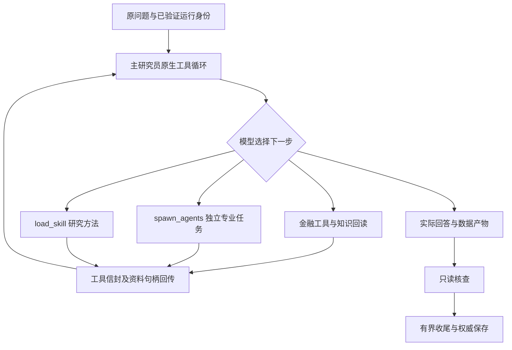

# FinSight Agent 指南

文档校准：2026-11-13。描述当前工作树的主研究员、专业角色、工具与交付合同。拟发布模型为用户选择的 APIKL `gpt-6.1-terra`；工具与 SSE 探针已通过，完整 60 题质量对照进行中。新候选未部署，最终 48 项产品验收未执行。

## 唯一研究循环

`POST /api/execute` 只调用 `backend/agent_runtime/service.py`。主研究员与专业角色共用 `loop.run(runtime, spec, task)`，模型实际返回原生工具调用后才执行。循环处理预算、工具协议、并发、截断续写和取消，不用关键词列表补取数、补图或改写答案。

`AgentSpec` 声明角色、模型、轮数、系统提示词、允许工具和终态提交工具。普通末轮不再提供工具；有 `terminal_tools` 的核查员末轮只保留结构化提交，不继续读数或计算。主研究员最多通过 `spawn_agents` 委派一层，同 run 共享数据、token 预留与模型/金融工具租约；专业角色不能嵌套。

| 模块 | 责任 |
|---|---|
| `loop.py` | 原生模型流、工具回传、连续 transcript、共享预算与取消 |
| `registry.py` | 实际工具参数校验、角色与调用作用域、信封适配、资料登记 |
| `envelope.py`、`adapters/` | `ToolResult` 与按 kind 的模型/界面投影 |
| `profiles.py` | Price、Technical、Fundamental、News、Macro、Risk、Deep Search 的声明性角色 |
| `prompts/`、`skills/` | 系统提示词、核查提示词、可读取的 Markdown 研究方法 |
| `compactor.py` | 保存系统/用户消息及近期轮次，旧工具内容改为可回读存根，必要时压缩研究笔记 |
| `data.py`、`citations.py` | 原始资料、整数来源编号、恢复与引用编号解析 |
| `verifier.py`、`finalize.py` | 只读核查、有界补交/报告修订、质量状态及报告构建 |
| `events.py`、`service.py` | 事件水位、blocks/checkpoint、唯一完成/取消/失败出口 |

模型上下文按本轮实际模型设置；令牌估算使用本地 tokenizer 并预留差异，实际计费以供应商 usage 结算。压缩失败保留可回读资料或明确预算错误，不裁掉用户问题来伪装完成。

`profiles.py` 限定专业职责和金融工具；实际注册表还提供授权的数据回读与计算工具。角色选择由模型依据任务决定，角色名称不是固定业务阶段。

| profile key | 职责 | 典型资料 |
|---|---|---|
| `price_agent` | 价格行为、动量、相对强弱与量价风险 | 报价、历史价格、基准、相对强弱、回撤与期权 |
| `technical_agent` | 均线、RSI、MACD 和指标形态 | 历史价格、当前报价、期权和市场情绪 |
| `fundamental_agent` | 增长、现金流、盈利质量与估值 | 财务报表、公司信息、盈利预期和 EPS 修正 |
| `news_agent` | 催化、报道可靠性与价格传导 | 公司新闻、事件日历、情绪与来源可靠性 |
| `macro_agent` | 通胀、利率、就业及跨资产传导 | FRED、官方宏观发布、经济事件和市场情绪 |
| `risk_agent` | 波动、回撤、因子敞口和下行风险 | 当前报价、历史回撤和因子暴露 |
| `deep_search_agent` | 监管文件、长文和深度取证 | 搜索及当前运行授权资料 |

并行任务回报摘要、来源和新资料句柄；派发成功仅代表受理。主研究员仍负责整合冲突、判断缺口、引用和最终交付。专业任务不能再派发任务，核查员也没有委派权。

## 工具、技能与资料

金融工具声明来自真实注册 schema，统一信封包含：

- `status: ok | empty | error`；
- `kind: quote | series | table | news | document | computation | chart | control`；
- 原始 `data`、来源、时点、notes 和结构化 error。

失败由协议字段判定，不扫描自然语言正文是否出现“错误”等词。角色只可使用允许的工具；服务端验证结构参数及数据句柄范围，技能、外部文件和工具结果不能扩大权限。

| 工具 | 用途 |
|---|---|
| `read_data` | 按句柄分页回读；表格按行、文档按字符，可选真实 columns/table |
| `search_memory` | 同时检索当前用户有权读取的知识资料和当前会话轻记忆 |
| `run_python` | 将代码与已授权数据交给独立隔离 worker |
| `render_chart`、`render_table` | 以真实字段生成图表和数据表，保留数据/来源引用 |
| `load_skill` | 按已安装 Markdown ID 读取方法全文 |
| `spawn_agents` | 主研究员并行派发独立专业任务，等待实际结果及新增句柄 |
| `update_plan`、`mark_report` | 更新研究计划或报告标记，不隐式替模型执行取数 |
| `propose_action` | 创建自选增删的结构化操作提案 |

`GET /api/skills` 与模型共享 `backend/agent_runtime/skills/` 的目录。用户最多选择 3 项，未知 ID 拒绝；方法不改变工具范围、委派深度或预算。

原始资料保存为 owner/session/run 范围的记录；来源首次出现分配 `[1]`、`[2]` 等整数。表格和图表引用真实数值，完整 OHLC 不重复放入每条来源。普通追问可恢复同会话未过期资料，每条记录原 TTL 不因新 run 续期；历史产物与当前新交付明确区分，最新行情仍需模型获取当前资料。

一轮研究中的三种内容不可混淆：工具信封供协议与错误处理使用，原始记录供 `read_data` 和计算回读，来源账本供引用解析。控制回执和计算方法可以解释过程，却不能增加金融来源数量。知识命中带当前 owner/session 的回读票据；文档更新、过期或失去权限后，旧票据不能读取新内容。

扩展工具先接入实际 schema、信封、角色权限和资料登记，再增加对应研究方法与回归样本。扩展技能只写方法和现有工具的正确用法；不能把每种用户措辞写成工具召回规则，也不能让技能暗中授予写操作权限。

## 只读核查与交付

本轮调用过数据工具的回答默认核查，报告模式与用户显式修订请求必须核查。核查员接收原问题、已生成答案、实际数据索引、来源及产物清单。

- 独立 Runtime/RunContext 使用父运行的 owner、资料、预算和用量；默认父模型，可显式传入其他核查模型。
- 最多 4 轮、90 秒，只开放 `read_data/run_python/submit_review`。
- `Review/ReviewFinding/Coverage` 拒绝额外字段，verdict 只允许 pass/revise/insufficient。
- finding.quote 必须在被核查答案中逐字存在；校验的是提交参数，不对自然语言意图做规则匹配。
- 无提交、无效提交、模型失败和超时返回 unavailable/error_code，不能冒充 pass 或 insufficient；取消传播并清理核查运行。
- 私有核查推理不公开。核查结果只标注，不删除或替换用户已看到的字句。

`answer.completed` 让正文立即可读，`review.started/finished` 独立展示核查状态；同一 SSE 保持到保存后的唯一 done。聊天 findings 由用户点“按核查意见修订”后开启新 run，使用 `review_revision` 结构参数和原 run 资料。coverage 未交付事项可自动追加一次；报告 findings 可在发布前修订一次，新增 `content.revised` 块并保留 `revision_of/review_id` 和原版。新核查通过 `supersedes_review_id` 关联前次核查。

这些追加/修订继续使用主模型、实际工具与原运行剩余预算。代码不生成固定模板答案、不自动完成模型没请求的工具。报告只有最终核查 pass、无 findings/未交付项、有效引用及完整收尾时才可发布；否则保留草稿和原因。详见[事件合同](execution-event-contract.md)和[事实治理](HALLUCINATION_MITIGATION.md)。

## 隔离计算

`run_python` 只进入 `backend/analysis_worker/` 的 dispatcher/job。环境提供 `datasets`、`frames`、`get_frame`、`pd`、`np` 和 `finsight`。原始 datasets 保留原值，计算只增加衍生记录。

`result` 支持有限数值 JSON 与 DataFrame；DataFrame 按行记录传输，索引需要显式 `reset_index()`。`valuation_scenarios` 的 `eps` 是单个正数，`multiples` 是列表；多个 EPS 假设分别计算后合并。计算失败的模型投影保留 `code_error` 中的类型、消息、行号；参数校验和数据表选择失败还提供真实参数 schema、可用表名与必填参数，供模型自行纠错。界面仍使用安全摘要，不展示原始日志或堆栈。`read_data/render_chart/render_table` 的可选 `table` 省略、null 或空串都表示未指定；有多张表时仍必须明确选择。

`finsight` 提供 `drawdown_episodes`、`consecutive_declines`、`moving_averages`、`series_statistics`、`compare_series`、`financial_ratios(frame)`、`valuation_scenarios(eps, multiples, currency=...)`。日期、频率、已收盘条件、共同基准与阈值由明确参数决定；峰谷回撤和连续下跌不是同一指标。财务比率保留主体、单位、期间和衍生来源；估值情景明确标为假设。结果赋给 `result`；只 print 的日志不算计算产物。隔离计算缺配置、资源不足或执行失败时明确不可用，不在 Web 进程运行开放代码。资源合同见[运行手册](11_PRODUCTION_RUNBOOK.md)。

## 权限、模型与独立预测

服务端 owner 只来自已验证身份。数据票据回读、恢复、操作确认和私有报告均重新检查归属。自选操作使用持久提案、payload hash 和确认收据；账户的结构化免确认设置可复用授权，不从用户文字或外部资料猜授权。

用户显式模型优先于研究配置，核查与专业角色不能静默借用另一用户或端点的密钥。供应商原始推理按账户设置与私有消息合同处理，单 run 展示上限 20,000 字符，不进入金融证据、普通复制或公开报告。

用户 Prediction/Outcome 与固定 US20 公开评估分别存储和评分。研究角色与旧 collector 类不是同一运行入口；27 个冻结预测依赖保留原合同，已退役的旧图/Agent 代码仅供测试参考。详见[模型选择](MODEL_SELECTION.md)、[公开预测账本](PREDICTION_TRACK_RECORD.md)及[历史图说明](archive/2026-11-13_documentation_refresh/LANGGRAPH_FLOW.md)。

## 验收状态

协议单测覆盖循环、工具信封、引用、权限、取消、核查、事件和持久化。答案质量使用 `tests/agent_eval/` 的工具回放与独立评分；M4 另用注错答案量检出率、未注错答案量误报率。题集分数、默认模型选择与真实用户体验不能用测试数量代替。

Step 5、Vectide 的历史注错核查、恢复批次和语义评审保留在 `tests/agent_eval/results/`，记录样本、未完成核查、误报及附带过度要求。它们说明对应模型与样本的表现，不是新 APIKL 模型的质量成绩。Vectide 周额度耗尽的失败也保留，不能当作短时限流或从统计里删掉。

当前真实模型验收必须绑定同一原问题、工具回放资料、runtime 摘要、预算、模型端点与独立评分协议。完整对照同时考察金融事实、引用、图表/计算交付、失败和耗时；单个能力探针不够。协议与存储回归从 `backend/tests/test_agent_runtime.py`、`test_research_run_delivery.py`、`test_research_run_postgres.py`、`test_knowledge_api_tools.py` 和 `tests/agent_eval/` 进入。测试具体数量属于一次执行结果，本文不设永久通过数。
