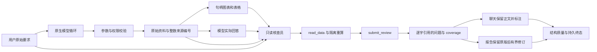

# 幻觉与错误事实治理

文档校准：2026-11-13。当前工作树以原始数据、结构化工具信封和只读核查降低事实与交付错误。核查已默认接入代码；用户选择的 APIKL `gpt-6.1-terra` 正在完整配对质量评测，新候选尚未部署，最终 48 项验收未执行。历史核查结果不能外推为新模型或线上准确率。

## 三层防线

第一层让成组数字直接走 `render_table/render_chart`，使用已取得数据句柄；来源使用稳定整数编号。模型不重抄表格数值，前端不执行模型脚本。

第二层核查员读取用户问题、原答案、实际资料索引与来源，必要时回读或用隔离 Python 重算。它判断句子含义与取证关系，代码负责参数结构、原文逐字存在、计算和引用编号的确定性校验。核查不依赖穷举措辞、同义词表或自然语言正则。

第三层只标注；需要变更时追加交付或保留版本后修订。已经显示的正文不因工具失败或核查问题被删除、模板替换或静默清洗。

## 核查合同

`Review` 包含 `verdict: pass | revise | insufficient`、`findings` 与结构化 `coverage`。每条 finding 包含 `quote/issue/evidence/suggestion`，quote 必须逐字存在于本次答案；coverage 每条为 `requirement/met`。三种模型均禁止额外字段，不允许通过 submit_review 提交重写后的 answer。

核查员使用父运行身份、数据、用量和预算，默认同一模型；显式不同模型仍受相同 owner 与额度边界。最多 4 轮、90 秒，仅有 `read_data/run_python/submit_review`，不得新增金融取数、改自选、派发任务或画图，内部推理不公开。

| 状态 | 含义与交付 |
|---|---|
| completed + pass | 有效核查提交；显示“已核查”，仍不等于外部事实绝对正确 |
| completed + revise | 原答案保留，列出待确认原句；聊天由用户点“按核查意见修订” |
| completed + insufficient | 资料不足以核实，保留缺口；报告保持草稿 |
| coverage 有 met=false | 可在原预算中自动追加一次实际缺少的交付，再核查 |
| unavailable | 核查未完成、超时、无效提交或服务错误；单独说明，不冒充资料不足或已通过 |

报告最多在发布前自动修订一次。新正文块以 `revision_of` 关联原块，前端可展开旧版本；用户触发的新轮修订通过 `review_revision` 保存来源消息、运行、核查及原答案。服务器验证原 run/消息/核查关系、答案摘要及提交意见，不能以按钮文案代替授权参数。

## 金融事实与工具边界

`ToolResult.status` 区分 ok、empty 与 error；失败判定读取机器协议，不搜索文档里的“失败”等措辞。原始来源、时间、币种、指标和缺失值保留，diagnostics 与事实分开。具体数据规范仍由行情网关及 `backend/tools/financial_facts.py` 负责：

- 单季、累计、年度、duration 和 instant 分开，EPS 不靠错误累计差分补造。
- 财务期间按真实起止日期和频率匹配，同比/环比无对应期间就保持缺失。
- 报价时间与分析时间不同，日收盘不能描述成即时行情；未知币种不默认为 USD。
- unknown 复权、股息、延迟或交易所不改成确定事实，freshness 不代表供应商延迟。
- 官方域名不证明发行人匹配，新闻摘要不等于实读公告、电话会或完整报道。
- CPI 指数水平与通胀同比、就业存量与新增就业、盘前盘后与场外成交均按实际指标区分。
- 没查到不代表不存在，有限新闻覆盖不支持“窗口内无其他事件”。
- 两期数值仅证明一次变化，期末收益不能证明全路径持续上涨或从未反超。

这些是数据与研究方法合同，不能写成运行时针对每种问法的关键词分支。新增错误类型先加入评测样本，必要时调整方法或核查提示词。

### 错误归属与最小修复

| 错误 | 应核对的事实源 | 修复边界 |
|---|---|---|
| 数字正确但公司、财期或指标错绑 | 原始工具记录及 fact_metadata | 修复数据选取或研究方法，保留原始记录 |
| 比率、收益、回撤或路径次数错误 | analysis.py、隔离 finsight 与输入句柄 | 用明确公式和参数重算，记录衍生来源 |
| 只有报道摘要却声称实读原文件 | 文档全文、发布时间及实际工具调用 | 补充模型取证或披露未读取的范围 |
| 编号有效但论据不受支持 | 引用原文、上下文和被核查句子 | 模型判断含义，编号存在不能自动判正确 |
| 图表存在但交付缺失 | 本轮 artifact 与 Review.coverage | 原预算内有界追加，旧图不冒充新交付 |
| 核查提出无证据的额外要求 | finding 原句及实际证据 | 独立评审误报和过度要求，不自动照单采纳 |
| 保存或重连丢失版本与核查 | blocks、提交水位及权威消息 | 修复协议和持久化，不改答案掩盖状态错误 |

数据适配、模型方法、只读核查和前端展示各有责任。增加模板兜底不能证明用户问题已被回答。

## 计算、图表和引用

`run_python` 只在隔离服务运行，开放代码不回退 Web 进程。环境保留原始 datasets，`finsight` 计算库提供回撤、连续下跌、均线、统计与共同基准比较；缺失、日期与单位由真实数据及明确参数确定。只 print、日志正常或 job 成功都不能替代所需 result 和用户最终交付。

图表和表格从句柄生成，缺失用 null，数值、日期、币种及来源不可被 renderer 改写。图表终值正确不证明文字解释正确；核查员根据实际产物检查交付覆盖。历史资料及产物复用不代表本轮重新采集。

整数引用只做协议解析并查询来源账本；未知编号计入质量原因，不从答案措辞猜测“有证据”。来源完整原文可回读，思考、控制回执、派发成功和计算方法不当作新的金融出处。

## 质量与发布

`finalize.py` 用实际引用解析、工具信封失败、循环收尾状态、核查 verdict/findings/coverage 合成 quality。执行完成、答案质量、可发布与持久化成功是独立维度。

报告需最终核查 pass、无 findings/缺项、有效引用和完整收尾；不满足时返回 blocked_report 草稿，不进入默认索引或公开分享。聊天保留可读正文和标注；核查未完成不清空已生成内容。数据或消息保存失败如实标记，不承诺跨进程恢复。

`quality.state=pass/warn/block` 是结构质量汇总，不是校准过的正确概率。聊天可以执行完成而质量 warn；核查模型 pass 也不能覆盖未知引用、截断收尾或未交付事项。正式报告没有独立校准置信度时使用 `confidence_score=null`，不生成看起来精确的百分数。

## 评测与历史证据

`tests/agent_eval/` 以固定工具回放数据比较运行预算、引用、产物、答案质量和耗时；独立评分模型按原题及 must/must_not 判分。核查员注错集覆盖改数字、反转方向、错绑来源等，未注错样本用于误报率。fixture、HTTP 200、非空正文、图表成功或核查员自报 pass 均不能独自作为真实验收依据。

历史 before 的原始失败、模型调用与实际 usage 保持原记录，见[冻结基线](reports/2026-11-07_natural_response_compute/BEFORE.md)。case6 图表正确但路径描述错误、case2 均值正确但最终交付缺失，不因新实现而改判。历史 Claim/六节点图规则见[历史说明](archive/2026-11-13_documentation_refresh/LANGGRAPH_FLOW.md)，不作为当前研究循环的隐藏后处理。

核查评测分别报告注错检出、未注错误报、核查未完成及附带过度要求，不得只保留检出率。完整研究评测记录 must/must_not、实际答案、工具回放、数据产物、独立评分和失败原因，评分模型须与被测模型区分。传输失败不能当作语义通过，修复后新跑批次不能覆盖原始失败。

当前完整配对对比、认证用户 48 项验收及部署后会话证据仍须逐项留证，见[运行手册](11_PRODUCTION_RUNBOOK.md)。RAG 指标与研究答案质量分开，见[检索评估](rag-evaluation-guide.md)；身份、保存和版本字段见[事件合同](execution-event-contract.md)。
