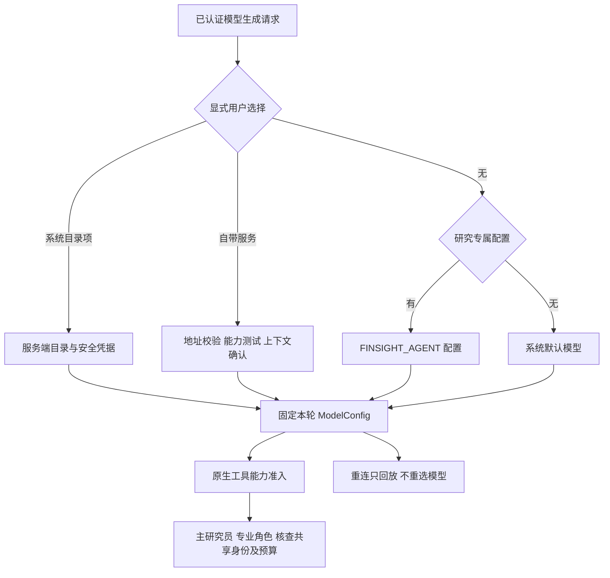

# 统一模型选择

文档校准：2026-11-13。以下为当前工作树的请求选择、供应商凭据、能力与评测合同。用户已选择 APIKL 的 `gpt-6.1-terra`，真实原生工具与 SSE 探针通过，完整 60 题配对对照进行中；新候选尚未部署。历史发布与实际服务状态以[运行手册](11_PRODUCTION_RUNBOOK.md)为准。

## 研究模型解析

`backend/agent_runtime/config.py` 优先采用用户本轮显式选择，其次使用研究专属 `FINSIGHT_AGENT_API_BASE/MODEL/API_KEY`，再采用系统目录默认。已开始任务保留创建时模型，同 run 重连只恢复内容，不重新解析模型或启动付费调用。

主研究员、专业角色和只读核查默认共享本轮模型；调用方可显式指定角色模型，但仍使用同 owner、用量与运行预算，不能静默借用另一用户、另一服务或冻结预测凭据。配置失败明确报错，不在公开输出后透明拼接另一个端点。

研究必须通过原生 tools/tool_calls 能力预检。缓存与实际探针结果区分，不凭“OpenAI-compatible”标签猜能力；不支持时拒绝研究，不能由应用替模型执行工具。预检成功不保证后续网络和工具调用成功。



## 系统目录与研究模型选项

`/api/models` 返回可用目录和实际 default_model_id，前端按目录显示，不硬编码默认名称。系统项不下发密钥，用户不能给系统模型选择覆写 URL/key。

| 选项 | 配置与边界 |
|---|---|
| 原 Step 5 / Step Plan | 保留既有 STEPFUN_API_KEY 与 Step Plan 入口，独立服务默认遵循原配置 |
| Step 5 Preview（按量） | ID 为 stepfun-api:step-5-preview；独立 FINSIGHT_AGENT_STEPFUN_API_KEY；官方 https://api.stepfun.com/v1 |
| qwen3.8-flash | ID 为 qwen-api:qwen3.8-flash；独立 FINSIGHT_AGENT_QWEN_API_KEY；用户授权的 https://api.kunyou.asia/v1；使用供应商默认推理设置 |
| 研究专属模型 | FINSIGHT_AGENT_* 三元组，不能影响固定 US20 模型 |
| 自带兼容服务 | 已认证用户显式测试并确认上下文发送后使用，凭据不进入持久偏好 |

Step 5 支持 low/medium/high effort；其原生研究上下文为 1M，运行 max_output 默认为 16384。模型官方上限与每次运行的输出预算不同，不能把官方 65536 上限写成所有调用点固定输出。未知模型默认使用 32768 上下文、8192 输出，实际显式配置由启动校验核对。

相关官方资料：[Step 5 能力](https://platform.stepfun.com/docs/zh/guides/models/step-5-preview)、[Step Plan 接入](https://platform.stepfun.com/docs/zh/step-plan/integrations/reasoning-api)。实际支持范围仍以本轮目录和探针为准。

### APIKL 当前接入与预算

API 基址为 `https://apikl.ai/v1`，`/keys` 是密钥管理页面，不是聊天接口。拟发布模型为 `gpt-6.1-terra`；此前请求的 `gpt-6-luna` 未作为当前生产默认配置。新的接口必须按原生 tools/tool_calls 与 SSE 实测准入，不能只因为 `/models` 返回名称就认定完整能力。

研究专属配置由服务端安全环境提供：

```dotenv
FINSIGHT_AGENT_API_BASE=https://apikl.ai/v1
FINSIGHT_AGENT_MODEL=gpt-6.1-terra
FINSIGHT_AGENT_CONTEXT_WINDOW=131072
FINSIGHT_AGENT_MAX_OUTPUT_TOKENS=16384
# FINSIGHT_AGENT_API_KEY 只由安全环境注入。
```

上方 131072/16384 是此次显式运行预算，与评测配置一致；未实测供应商上下文极限，不当作模型官方规格。`config.py` 对未知模型的默认预算仍为 32768/8192；研究专属模型使用显式 runtime 设置，匹配该配置的系统选择沿用设置。配置预算、模型官方上限、返回 usage 和实测完整上下文窗口是四种不同事实。

2026-11-13 的 M0 实际返回 prompt usage 为 101285 tokens，长输入请求完成；96×96、308 B 的四象限 PNG 的颜色识别 4/4 正确，因此本轮允许图像输入。该结果不证明完整 131072 上下文可用、金融图表 OCR 精度或供应商最大窗口；完整原件和 usage 见 [M0 实测记录](../tests/agent_eval/results/m0_apikl_terra_capacity_vision_20261113.json)。

评测使用单独前缀 `FINSIGHT_EVAL_APIKL_API_BASE/MODEL/API_KEY/CONTEXT_WINDOW/MAX_OUTPUT`，由 `tests/agent_eval/run.py --provider apikl` 读取。评测选项不修改生产默认或冻结 US20 配置。发布清单固定 `model_provider=apikl`，validate/deploy/rollback 沿用清单；显式供应商不一致时拒绝，不能回退旧 Vectide 密钥。模型、端点与预算必须与完整质量报告一致后才能发布。

## 预算与失败

原生研究按 RuntimeSettings 使用 FINSIGHT_RUN_TIMEOUT_SECONDS、FINSIGHT_RUN_TIMEOUT_BRIEF_SECONDS、FINSIGHT_RUN_TIMEOUT_REPORT_SECONDS；当前部署配置为研究/brief 300 秒、报告 600 秒；未配置新名时仍兼容旧预算名称及其默认值。模型上下文、输出额度、轮数、整 run token 与 provider RPM/TPM 分别约束。

循环截断后在剩余预算内续写；供应商 429 的有界退避、模型探针、工具、压缩与核查各有真实成本记录。主回答预留剩余时间的四分之一、最多 90 秒用于核查，循环依据上一轮实际模型耗时安排无工具的最后一轮；必要追加或保留原版的修订最多 120 秒，阶段切换不延长原截止时间。M4 核查最多 4 轮/90 秒，缺少结构化提交时在剩余轮数内要求模型提交，代码不代填结论；超时或无效结果不能伪装通过。具体调用次数和费用以 usage 为准，不以角色数量推定。

原 LangGraph 合成的 JSON Mode、长超时和节点级参数属于历史调用点，不是当前工具循环预算。固定 US20 的 4096 输出、60 秒尝试和冻结交易窗口继续独立；用户 Prediction 的预算与后端接口合同另行管理，不被新研究设置批量覆盖。

## 自带服务与数据边界

用户输入公共 HTTPS 服务地址、模型 ID 和自己的 key，测试成功后应用。应用前确认外部服务会收到研究上下文，包括用户问题、系统提示词、RAG 结果与数据源内容；后端要求 context_acknowledged。地址、模型或 key 改变后重新测试。

系统模型 ID/effort 和自定义非敏感地址、模型名可按账号保存；key 与上下文确认仅在页面/请求内存中，不写入浏览器持久存储、数据库或服务端端点池。刷新后缺少 key 时阻断新请求，不能静默切默认。退出或换账号清除凭据，同账号 token 刷新不丢失仍有效的页面状态。

只允许经过校验的公共 HTTPS 地址，不接受内网地址、重定向或由模型提供的任意新端点。标准兼容路径归一是机器格式处理，不推断用户自然语言意图。

## 认证、请求头与隔离

目录和能力查询可公开只读，显式模型选择与连接测试要求已验证身份，测试受账户限流。X-FinSight-Model 只随模型生成请求发送，不随行情读取、目录、取消、重放或公开战绩请求发送；base64 不是加密，传输必须使用 HTTPS。

供应商原始错误、模型头和连接测试体不进入普通日志。公开 metadata 仅投影非敏感模型信息。核查员内部推理不向用户公开，主研究员的供应商原始推理按账户开关和私有消息合同处理。

个人异步 Prediction 保留创建时选择与非敏感模型指纹；重启后不能恢复用户凭据的旧任务明确结束，不换用他人或默认模型继续。固定 US20 则使用冻结系统策略，清除浏览用户选择，与用户自带 key 无关。

## 验证

模型目录、认证、请求头范围、凭据生命周期、未知模型预算、工具能力探针、角色/核查同 owner 额度及冻结预测边界分别测试。成功连接不能代替真实研究质量或端到端登录验收。历史 Vectide 配对核查测量已完成；当前 APIKL 同资料完整对照、48 项产品验收及新候选部署仍待收口。

旧 `--provider vectide` 与其私有 `FINSIGHT_EVAL_VECTIDE_*` 前缀保留供历史复现；周额度耗尽、HTTP 502、超时和恢复批次均保留原结果。新旧供应商使用同题、同资料、同运行预算口径的配对评测，独立评分与传输错误分别记录。能力探针只能证明被测请求可用，不能证明完整研究质量或服务稳定性。

模型切换的完成证据包括：实际模型标识与安全 metadata、原生工具/SSE、完整质量报告及 runtime 摘要、持久化与取消、普通账号请求和浏览器显示。目录、页面选择、服务端实际运行模型和部署清单需要一致；不能仅修改前端标签就汇报切换完成。
