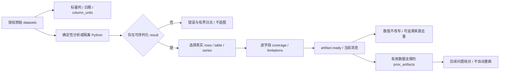

# Report 与 Chart 合同

更新时间：2026-11-07　前端基线：ECharts 6

默认原生对话通过`artifact.ready`输出声明式`ResearchArtifact`，作为消息blocks保存；报告ReportIR与Markdown `<chart>/<chart_ref>`仍为兼容展示格式。优先使用真实数据引用，避免LLM重写数值。

原生产物携带dataset_refs/source_refs、真实rows、图型/序列/单位/方法与局限，由ResearchArtifactView/ECharts渲染；不执行模型任意JS/formatter。区间日期对齐真实类目，连跌小图包含前一期基准和结束观测；百分比原值不再乘100，unknown复权/股息显示未注明。真实实例/悬停验证见 [REAL_CHARTS](reports/2026-11-07_chat_design_alignment/REAL_CHARTS.md)，核心图表通过不等于候选解释全部可信。

## 原生数据、缺值与来源



`inspect_dataset` 用于查看资料结构，不把完整元数据重复塞入模型上下文：默认选非嵌套的标量列、日期，保留 `column_units`；可显式指定 `columns/table`。最多 12 行，实际 `returned_rows/row_count/has_more` 分开；超过 8000 的保守上下文估算会减少返回行数，仍过大则返回 `dataset_projection_too_large`，不能悄悄改值或单位。

隔离 Python 的 `get_frame` 与 SEC inspect 表名对齐，支持 `companyfacts` 及 `period_end/period` 别名，同时保留原平行数组字段和已有标量上下文。返回图表数据时，NumPy 标量转为原生 JSON 值，`pd.Timestamp` 转为 ISO 字符串；NaN/Infinity 仍应由代码明确处理后再返回，不能让编码器伪补。结果大小和日志边界不变。

每个实际 series 字段都有 `coverage[field]`：

| 字段 | 含义 |
| --- | --- |
| `points` | 当前图表总行数 |
| `valid` / `missing` | 有效数值与缺失点数；null 不补成零 |
| `leading_missing` | 当前图表开头连续缺失点数；全部缺失时为 points |
| `first_valid` / `last_valid` | 首末有效值对应的真实 x 坐标；没有有效值时为 null |

`limitations` 直接说明缺失与开头空值。均线先在完整历史上计算、再裁剪显示窗口时，开头可能已经有值；不能仅凭窗口是 MA20 就断言“前19点为空”。此类陈述须与 coverage 及实际 rows 一致。

`indexed_comparison` 返回统一的 `comparison_stats`：逐序列下降期数/负收益期数/终值、领先/持平期数、严格单调性及 `crossovers`。交叉由纯函数 `comparison_crossovers` 统一计算，每对记录包含 `left/right/count/dates/dates_truncated`；它表示已有领先方的交换，基准日持平后的首次分离不计，途中持平不会重置前一个领先方。日期取新领先方首次出现的观测日，列表最多保留最后 24 个日期，总 count 不截断。文字中的次数、日期或“全年领先”须按同一定义与该统计/完整源序列核对，不能由终值或旧回执猜测。

连续下跌区间标注以真实开始/结束观测对齐 x 轴。日期边界包含结束日；带时间的边界保持盘中精度。小图有 `baseline_included/periods` 时包含下跌前一期真实收盘价，点数为下跌周期数加一，既不统一成 0/100，也不伪造基准。主图用短区间编号，完整日期/周数/跌幅在列表和实际 tooltip 中对应；小图独立使用线性纵轴并说明，不继承主图的对数轴。

`source_refs` 是引用记录 ID，不能直接当作独立来源数量。图表展示按可追溯 HTTP(S) URL 去重，无 URL 时按明确的数据 provider 去重；工具包装、`analyze_dataset/run_analysis_code` 等计算方法不作为额外数据来源。同一 provider 已有 URL 记录时，不再重复计数仅 provider 的投影。原始引用 ID 与数据保持不变，计算说明留在 method。时间按原始日期/时区友好展示，未知不补当前时间。

`prior_artifacts` 只保留仍有有效 dataset_refs 支撑的历史图表 spec/coverage/method/limitations 等投影，最多 30 项，不复制整份 rows，不发新 artifact.ready。它用于核对“刚才图上”的覆盖和结论，不能充当新的计算或当前行情。

## 报告与研究结果

legacy 报告消费唯一 `research_result` 的任务、事实、Claim、引用和缺口；原生报告从正式 `answer`/最终 `response` 与实际引用构建，安全 `progress` 仅作过程记录。两者都不能在展示时重写事实或补造来源；私有思考不进入公开报告。

legacy 质量由 `evaluate_result_quality` 合并；原生交付由 `service.py` 的 quality/reasons 与 report_quality 共同决定。两者使用 `pass/warn/block`，已有阻断不可被报告构建覆盖。完整报告必须有受支持论据并满足必需维度；facts-only 或缺口结果可返回 `blocked_report` 预览，但不能进入报告索引、分享或最终缓存。内部 conflict ID 留在诊断数据，正文说明实际冲突的指标和期限。

`done`、`publishable`、`archived`、`persistence_status` 各有独立含义。正文生成后须保存服务器终态与助手消息，报告归档失败或会话保存失败均保留预览并明确提示。刷新恢复按 run/message ID 读取权威内容，不能依赖浏览器最后一次快照。

缺总体判断时 `report_quality.conclusion_status=unavailable`、`sentiment=unknown`、`confidence_score=null`。不把未知写成中性，重验和历史回放不补默认 0.5/0.7。没有校准依据的方向、证据、来源置信度不显示百分比；前端展示可追溯来源数量和实际缺项。有依据的 neutral 仍可显示为中性，partial 保留有效正文与证据。

卡片、全屏与历史只读页共用 `ReportPresentation`；未完成项在正文前说明，来源及执行详情默认收起。纯展示派生不改写服务器 canonical 正文。

原生候选最多做一次禁工具修正。无支持的旧候选删除/替换，不逐段生成“已撤回”；最终仍不足时保留部分回答与质量原因。图表成功、计算返回 result 和 `completed` 不能替代逐项最终答案验收：请求的数值必须真正交付，不能只留在 progress 或调试日志中。

## ReportIR chart

```json
{
  "type": "chart",
  "content": {
    "option": {
      "xAxis": {"type": "category", "data": ["2023", "2024"]},
      "yAxis": {"type": "value"},
      "series": [{"type": "line", "name": "Revenue", "data": [100, 120]}]
    }
  },
  "metadata": {"chart_type": "line", "title": "Revenue", "unit": "USD bn", "as_of": "2024-12-31"},
  "citation_refs": ["SRC-1"]
}
```

也兼容 `labels + values`、`labels + datasets` 或直接 `xAxis/yAxis/series`，前端会补成 ECharts option。

## 对话标签

- `<chart>`：小型内联数据；必须来自本轮证据，不允许模型编造。
- `<chart_ref>`：引用后端真实数据或已生成 artifact；推荐用于行情、财务和回测。

价格语义是强约束：`line_price`、K 线/量价等价格图，以及标题、series 名或精确币种单位明确表示“股价/收盘价/价格走势”的普通 `line`，前端必须改走真实 K 线接口，不能消费 `<chart>` 内的模型数组。价格线展示收盘价，不得把累计收益率伪装成金额；收益率图必须明确使用 `%` 单位。

引用对象至少包含可解析的资源/series 标识、图表类型、标题和单位。找不到引用时显示明确错误/降级文本，不用示例数据顶替。

## 安全与质量

- `citation_refs` 必须指向报告 citations 中存在的 source id。
- 所有时间序列标明时区/as-of、币种、单位和复权口径（适用时）。
- 财务序列保留实际财期、单季/累计频率与指标定义；不能把非日历财年改成日历季末，也不能混画季度与年度值而不说明。
- 多标的图表逐项核对发行人和证据绑定；官方 URL 不等于已核验属于目标公司。
- 前端不得执行任意函数、HTML 或由模型提供的 JavaScript；只接受数据型 ECharts option。
- 限制点数、series 数和字符串长度；超大数据在后端抽样/聚合。
- 缺失值使用 `null`，不要用 0 冒充。
- 图表说明不得与 series 数值或引用证据冲突。
- tooltip 与坐标轴必须按币种/百分比格式化并限制小数位，不显示二进制浮点长尾。
- 客户端异步注入的图表标记不属于服务器权威正文，不能通过整份会话快照覆盖已保存回复；需要刷新可恢复的图表应使用服务器 artifact 或明确的持久视图数据。

修改合同必须同步后端 ReportIR/schema、前端 SmartChart/报告渲染、OpenAPI/TypeScript 类型和单测。
