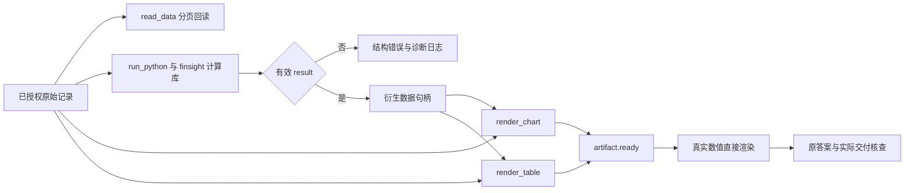
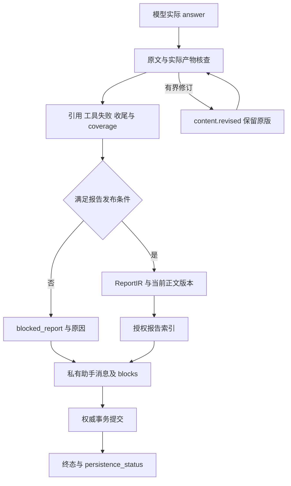

# 报告、图表与数据表合同

文档校准：2026-11-13。本文规定当前原生研究的数据产物、数值口径、报告版本和发布条件。拟发布 APIKL 模型正在完整质量对照，新候选尚未部署，真实模型与认证浏览器最终验收仍需独立记录。

## 原生数据产物

`read_data(handle, columns, table, offset, limit)` 读取当前 run 的授权记录或已授权知识票据。表格按行、文档按字符分页，返回实际 offset/next_offset/has_more，不扫描全文猜字段、表名或单位。原始内容留在账本，模型投影受上下文预算限制。

`render_chart` 与 `render_table` 只接受真实句柄和已存在列，产物包含 artifact_id、kind、title、dataset_refs/source_refs、spec 和真实 data.rows。数据表不需要模型重抄数字，前端 ResearchArtifactView 统一呈现，禁止执行任意模型 JavaScript、HTML 或 formatter。

开放 Python 只交给独立 worker。datasets 保留原包，frames/get_frame 提供表格，finsight 提供回撤、连续下跌、均线、统计和共同基准比较。需返回的数据赋给 result；日志、只 print 或 worker healthy 不等于已有可展示计算结果。SEC 多表、财期、币种与缺失值均保持实际来源含义。

### 声明式产物字段

| 字段 | 含义与限制 |
|---|---|
| `artifact_id/version/kind/title` | 产物身份、协议版本与显示类型；标题不是数据来源 |
| `dataset_refs` | 真实原始或衍生句柄，按当前运行归属校验 |
| `source_refs` | 从输入资料关系解析的出处编号；不凭模型文字增加来源 |
| `spec` | 图表类型、x、series、scale、annotations 或表格字段 |
| `data.rows` | 已登记资料的真实值；缺失保留 null |
| `method` | 衍生计算方法、参数与基准；估值情景明确标为假设 |
| `coverage/limitations` | 数据有效点、缺失、起始空值、首末有效坐标及局限 |

`analysis.render_chart` 当前支持 line、bar、scatter、candlestick、line_with_event_windows；只允许 linear/log 比例。x 和 series.field 必须真实存在；K 线需要完整且关系一致的 OHLC，log 数值必须为有限正数。无法满足时返回结构错误，不生成空图或伪造列。规模限制来自实际函数与工具 schema，不能通过模型自定义 formatter 绕过。

`render_table` 与图表共享来源和数据句柄，但使用表格协议。当前轮数据产物进入 blocks，恢复的 `prior_artifacts` 只表示已有历史资料。模型正文中的 Markdown 表格是模型文本，不能等同于由句柄渲染的逐值数据表。

## 数值与图表口径

- 原始数值、财期、时点、币种、单位与复权信息随数据保留；未知不补默认值。
- 图表缺失值用 null，不能补成零；开头均线空值按实际显示窗口说明。
- 日期边界含实际结束观测，需要收益基准时使用真实前一期收盘，不制造起点。
- 回撤事件、连续下跌期数和区间收益分别定义；频率、已收盘条件和阈值来自明确计算参数。
- 多标的比较使用共同有效日期与一致基准，基准首次分离不当成领先方交换；次数、日期与终值分别核对。
- 图表源数量按实际可追溯来源统计，计算方法、包装工具和重复记录不算新增金融来源。
- 图表成功不能证明“全程领先”“持续上涨”等文字结论，核查需回读完整路径或重算。
- 前端图例、坐标轴与 tooltip 保留币种/百分比口径，避免浮点长尾和重复乘百。

图表的 coverage/limitations 描述真实有效值、缺失、起始空值与首末有效坐标；核查 coverage 则描述用户交付事项，两个字段属于不同协议对象，不能混用。历史 prior_artifacts 与本轮 artifact.ready 区分，旧图不因恢复而成为新交付。

## 报告版本与质量

`finalize.py` 从模型真实 answer、实际引用和产物构建 ReportIR。正式报告不包含供应商私有思考或核查内部推理，不用旧 Claim/图节点补丁重写答案。

数据回答默认核查，报告必须核查。核查员只读既有数据，submit_review 提交 verdict/findings/coverage；quote 必须逐字存在。资料不足与核查超时分开，不能用一条通用“已核查”掩盖不可用。

| 情况 | 处理 |
|---|---|
| pass，且无 findings/未交付项、引用有效、完整收尾 | 可进入报告发布与保存 |
| 有 findings | 报告最多自动修订一次，保留原版再核查；聊天由用户显式触发新轮修订 |
| coverage 有未交付项 | 原预算内最多追加一次实际交付，不覆盖已显示原文 |
| insufficient 或 unavailable | 草稿与原因保留，不发布为已核查报告 |
| 数据、消息或报告保存失败 | 保留预览并说明，不能显示已保存或可恢复承诺 |

自动修订新增 content.revised 块，以 revision_of/review_id 关联原始正文，旧块可展开。新核查用 supersedes_review_id 保留审计链。用户修订通过 review_revision 关联原消息与运行，云恢复仍保留关系。渲染、复制与导出采用当前正式版本，不修改保存的旧文本。

done、quality、publishable、persistence_status 分别表示执行结束、质量、发布资格和持久化结果；不能互相替代。当前原生报告方向没有独立校准判断时使用 sentiment=unknown、confidence_score=null，不填默认置信度。

### 正文、版本与持久化数据流

ReportIR 包含 report_id、title、sections、citations、report_quality 与 meta 中的实际 runtime/model/run/artifacts。正文由模型实际答案构成，citation_refs 按来源账本解析。当前没有独立校准的方向和置信度时保持 unknown/null；模型自述“有信心”不能填成统计概率。

报告索引失败与助手消息保存失败均属于持久化问题，不能因浏览器已有完整正文就宣称可分享或恢复。公开分享只投影允许的报告字段，供应商思考、私密模型配置、控制回执和核查内部推理不进入公开报告。

## 历史格式兼容

已有 ReportIR chart、数据型 ECharts option、旧 chart/chart_ref 文本格式可按历史展示合同读取；这不是原生模型的新工具协议。当前含 blocks 的研究消息只渲染文本与 artifact，前端不因正文出现图表标记就补取行情或改变正文。无 blocks 的旧消息仍保留既有展示兼容。

历史格式的价格图仍不得使用模型编造数组，需真实行情或已验证产物；缺失显示不可用。历史共享报告与归档数据不因新协议批量改写。

## 验收与边界

数据与表格逐值一致、引用可解析、权限、严格字段、缺失、真实计算、版本恢复和浏览器显示分别验证。单位测试及布局 fixture 不等于真实金融答案通过；报告发布需正文、产物、核查与保存闭环。

历史真实图表证据保留在 [REAL_CHARTS](reports/2026-11-07_chat_design_alignment/REAL_CHARTS.md)，不改判历史失败。当前 M3/M4 评测、48 项产品验收和部署后真实会话状态统一见[运行手册](11_PRODUCTION_RUNBOOK.md)。

## 行情放大与键盘恢复

当前右栏 RightPanelMarket 使用同一份已取得的行情、周期和来源生成小图与 MarketChartDialog 放大图；放大只改变绘制尺寸及成交量面板比例，不重新请求研究或替换数据。放大窗口展示实际收盘与来源时点，支持 Escape、焦点限制和关闭后恢复原按钮焦点。缺少行情时禁用放大入口。桌面和 390 px 浏览器验证同时检查可见行情线/柱、成交量、无横向溢出与关闭行为。

历史 K 线和当前报价可能来自不同供应商；放大图只标注历史行情自己的来源、时点和币种，不用报价 metadata 覆盖。币种缺失时显示“币种未注明”。混合 Yahoo Finance 历史与 Twelve Data 报价的桌面/移动复验通过。
