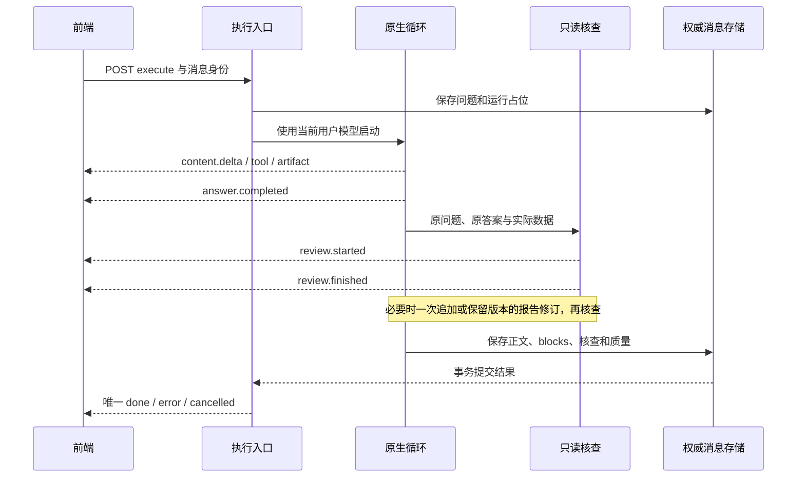
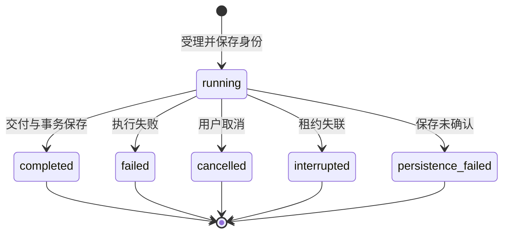

# 研究执行事件合同

文档校准：2026-11-14。本文描述当前源码的原生研究事件、核查及版本化交付合同；旧事件只保留历史展示兼容。模型质量与实际发布状态统一见[运行手册](11_PRODUCTION_RUNBOOK.md)。

## 身份、顺序与终态

`POST /api/execute` 是唯一研究 SSE 入口。请求可携带 session_id、run_id、client_user_message_id、client_assistant_message_id、history、context、options、skill_ids、images 和结构化 review_revision。owner 来自已验证身份，不能由这些字段覆盖。

服务器先保存问题、运行和助手占位，再启动研究。schema v2 事件携带 `run_id/session_id/message_id/agent_id/attempt_id/stream_epoch/seq/event_id/timestamp/payload`。seq 在当前流内单调递增，epoch 防止旧事件污染新快照。正文增量可同时以 `type=token/runtime_type=content.delta` 兼容旧消费者，前端只能消费一次。



`answer.completed` 只表示正文已生成，可立即阅读；它不是最终 done，也不承诺核查或持久化完成。同一 SSE 持续到核查与保存结束。任何终态只能走一次；保存失败明确返回 persistence_failed/unconfirmed，不能用展示成功代替数据库提交。

SSE 同时携带 `type=done/error/cancelled` 与 `runtime_type` 时，终态 `type` 优先；业务别名不能吞掉终态。例如保存失败的 `type=error` 与 `runtime_type=delivery.persistence_unconfirmed` 仍进入错误终态处理。客户端保留已生成正文，显示保存失败，并提供复制/导出；不能把流结束后的通用错误替代这条明确状态。

### 请求字段与权威身份

| 输入 | 用途 | 服务端约束 |
|---|---|---|
| query、history、context、tickers | 用户问题与可见研究上下文 | 不授予 owner 或写权限 |
| session_id、run_id、客户端消息 ID | 会话/运行关联与幂等占位 | 核对已认证 owner；冲突不重跑 |
| options、output_mode、analysis_depth、budget | 显式输出与运行设置 | 在本轮预算和 schema 允许范围内使用 |
| skill_ids | 已安装研究方法 | 最多 3 项，未知 ID 拒绝，不扩工具权限 |
| images | 当前轮 PNG 图片 | 最多 3 项，由 vision 验证格式和大小 |
| show_provider_reasoning | 当前用户的供应商字段显示选择 | 不公开核查员内部推理 |
| resume_from_run_id、review_revision | 新轮续研或显式按核查修订 | 校验原 owner/session/消息/核查及原文摘要 |

`X-FinSight-Model` 属于认证模型生成请求的请求头合同，传输必须 HTTPS；不得随行情、目录、重放、取消或公开战绩请求发送。服务器保存的 run/request 指纹和已验证身份为事实源，客户端显示 ID 不是授权凭证。

## 事件与块

| 事件 | 内容与消费 |
|---|---|
| `run.accepted` | 本轮已接收及运行身份 |
| `content.delta` | 原文增量与 block_id，不进行答案清洗 |
| `content.block_finished` | content_phase、finish_reason、completion_status；没有文本字段时不清空原文 |
| `content.revised` | 报告修订的新 block_id、text、revision、revision_of、review_id；原块保留 |
| `answer.completed` | status=completed、review_pending=true；立即落定可读正文 |
| `review.started/finished` | 结构化核查状态，按 review_id 更新同一个 review 块 |
| `tool.started/result/failed` | 实际工具生命周期；display 由信封生成，输入/结果经有界脱敏投影 |
| `agent.started/finished` | 并行专业任务和实际结果，不把收到委派当作已完成 |
| `artifact.ready` | 真实句柄生成的图表或表格 |
| `action.proposed/finished` | 结构化操作提案及收据 |
| `reasoning.delta/completed` | 当前用户允许展示的真实供应商字段；不制造思考，不公开核查员私有推理 |
| `delivery.persistence_unconfirmed` | 快照保存未确认，提示保留当前内容 |
| `snapshot.reset` | 已提交 blocks 与水位接管，随后继续消费新事件或终态 |
| `done/error/cancelled` | 运行终态及质量、持久化状态 |

块类型为 text、reasoning、artifact、action、review。text 的 progress 仅在展开过程里显示，不参与普通复制或正式报告；answer 是实际回答。多段正常回答按真实顺序保留。reasoning 单 run 的公开投影最多 20,000 字符，owner 私有保存，不进入金融证据、公开报告或原始开发日志。

EventSink 当前将 attempt_id 与 stream_epoch 设为同一流标识，不把它理解为每次上游 HTTP 尝试编号。event_id 由 epoch 与 seq 组合；数据去重、快照接管和运行归属各自校验。`content.delta` 兼容输出的 token/content 与 runtime_type/payload 指向同一增量，客户端只消费一次。

## 核查 payload

```json
{
  "status": "completed",
  "review_id": "REVIEW_ID",
  "verdict": "revise",
  "findings": [
    {
      "quote": "原答案中逐字存在的句子",
      "issue": "发现的问题",
      "evidence": "已读取的依据",
      "suggestion": "建议如何修订"
    }
  ],
  "coverage": [
    {"requirement": "用户要求的走势图", "met": false}
  ],
  "supersedes_review_id": null,
  "answer_sha256": "被核查原文的摘要"
}
```

上例是协议形状示例。status 可为 running、completed、unavailable；只有有效提交的 completed 才有 verdict/findings/coverage。unavailable 带 error_code，不伪装 pass 或 insufficient。quote 校验逐字子串，coverage.met 为布尔值，提交模型禁止额外字段。

持久块为 `{id:review_id,kind:"review",review:payload,revision,seq,agent_id}`。重复事件不会产生重复核查块；完成后的迟到 started 不回退状态。新核查通过 supersedes_review_id 关联旧核查，旧块仍可展开。answer_sha256 绑定被核查的精确原文。

前端只用原样 quote 定位 Markdown 文本，不同空格或改写句子不能被猜成同一位置。显示标注不修改消息正文，历史恢复也不裁掉正文首尾空格。依据中的句柄、工具名及 error_code 仅放在折叠详情。

## 追加与保留版本的修订

coverage 有未交付项时可自动追加一次；聊天 findings 保持原答案，由用户点修订开启新 run。报告 findings 可在发布前自动修订一次，主模型仍可使用实际工具，并受原剩余时间/token/并发预算约束。

报告修订事件：

```json
{
  "block_id": "NEW_ANSWER_BLOCK",
  "text": "完整修订稿",
  "revision": 1,
  "content_phase": "answer",
  "revision_of": ["ORIGINAL_ANSWER_BLOCK"],
  "review_id": "REVIEW_ID"
}
```

前端保留原块，当前正文投影排除被新版本引用的旧块；旧正文以“修订前的回答”展开。正常路径不发送删除答案或空文本替换事件。

用户主动修订仍调用 `POST /api/execute`：

```json
{
  "query": "按核查意见修订",
  "resume_from_run_id": "SOURCE_RUN_ID",
  "review_revision": {
    "source_message_id": "SOURCE_MESSAGE_ID",
    "source_run_id": "SOURCE_RUN_ID",
    "review_id": "REVIEW_ID",
    "answer": "原答案，逐字保留",
    "findings": [],
    "coverage": []
  }
}
```

query 是显示文本；后端只根据 review_revision 对象进入修订上下文。服务器核对 owner/session、原 run/消息/核查 ID、原文摘要、findings/coverage 和 resume 一致性；冲突拒绝。新 run 与新消息保存原版关联，done 和 assistant_message.review_revision 在云端恢复后仍可回到原答案；按钮不复用“重新研究”的原位覆盖行为。

## 其他显式操作

| 入口 | 边界 |
|---|---|
| `POST /api/execute/runs/{run_id}/instructions` | instruction/instruction_id；同 owner 的活动 run 在下个模型边界接纳，同 ID 异文冲突 |
| `POST /api/execute/runs/{run_id}/actions/{action_id}/confirm` | payload_hash/confirmed；重新校验 owner/run/action，持久收据保证幂等 |
| `resume_from_run_id` | 新 run 恢复同 owner/session 的有效资料，不续期旧记录，不重跑旧付费任务 |
| `GET /api/skills`、`skill_ids` | 当前 Markdown 技能目录，最多 3 项，未知 ID 拒绝，方法不扩权 |

自选增删只允许 watchlist.add/remove。免确认由当前账号结构化布尔设置决定，不依赖自然语言授权匹配。网页、检索内容和同伴消息不能授权。

## 快照、恢复与取消

`EventSink` 按真实事件累积 blocks、thinking、response、artifacts，检查点至少间隔约 1 秒尝试保存，提交水位位于权威消息 JSON，不新增数据库结构。相同 epoch 的旧水位不能覆盖新快照；终态后不再接收前缀快照。

`GET /api/execute/runs/{run_id}` 返回本轮身份、状态与最终 result。`/events?after_seq=N` 使用当前缓冲或已提交 snapshot.reset/终态恢复；租约失联进入 interrupted，不重新执行模型。当前执行 task、追加要求和取消路由仍在单个 backend 进程，持久化不代表分布式任务调度。

前端停止时中止网络并请求取消；取消传播给同 run 模型、工具、子代理及核查，已产生内容可以保留。恢复后主动结束网络连接不等于用户取消。换账号、删除消息、清空或新 run 接管后，旧回复不得复活。

| 字段 | 独立含义 |
|---|---|
| run_status | running/completed/failed/cancelled/interrupted/persistence_failed |
| answer_status | 当前答复完整性；原生终态使用 answered/partial/unavailable 等已声明值 |
| quality.state | pass/warn/block，由引用、工具失败、核查与收尾状态合成 |
| publishable | 是否满足报告发布条件 |
| persistence_status | saved/failed/unconfirmed/ephemeral；只有 saved 承诺服务器事务已保存 |

done 可包含 response、report 或 blocked_report、reviews、report_revision、review_revision、blocks、quality、metrics 和服务器助手消息。数据库不可写时保留失败预览，不承诺恢复。相同 owner/run 再次 POST 返回既有结果；换 query 冲突，主动重做使用新 run。



恢复读取已经提交的事实，不增加上述状态之外的“自动重新执行”路径。执行完成但质量 warn/block 仍有可读消息；publishable=false 限制报告发布，不能清空聊天原文。检查点保存未确认先发 delivery.persistence_unconfirmed，最终未保存则返回 error/persistence_failed；unconfirmed 不是 saved。

### 幂等与迟到消息

- 相同 run 与相同请求复用已有结果；不同 owner 或不同请求指纹拒绝。
- 同 epoch 的较旧 seq 不覆盖新快照；新 epoch 接管时旧连接不得追加正文。
- 重复 review.finished 更新同一 review_id；迟到 started 不回退已完成核查。
- 终态后停止接受前缀快照；账号切换、消息删除或新 run 接管后旧 token 不复活。
- 操作确认以 action_id、payload_hash 和持久收据幂等；显示文案或外部网页不能授权。

这些约束同时适用于即时 SSE、REST 快照、云端助手消息和历史恢复；只有前端内存展示一致不能算持久恢复通过。

## 文案单一入口

对话核查固定文案统一位于 `frontend/src/locales/zh.ts`，遵循计划 11.3(5)，不引入 i18n 框架：

| 键组 | 实际文案 |
|---|---|
| zh.chat.review 状态 | 正在核查回答…；已核查；有待确认的内容；资料不足以核实；核查未能完成，回答已保留。 |
| 操作和覆盖 | 按核查意见修订；尚未交付 |
| 说明和详情 | 依据；建议；核查详情 |
| 版本关系 | 修订前的回答；此前核查；查看修订前的回答 |

计划 11.3(2) 的单一错误映射在 zh.errors：review_timeout、review_invalid_submission、review_turn_limit、review_not_submitted、review_model_error、review_failed、review_cancelled 各给中文事实、建议和 retryable。错误码仅在诊断详情展示，核查不可用不显示“资料不足以核实”。

## 实现与验收

后端生产者为 `events.py/loop.py/registry.py/verifier.py/finalize.py/service.py`，持久接线为执行 Router 和 research_run_store。前端消费为 `researchStream.ts/useChatStream.ts/ChatList.tsx/ResearchReview.tsx`。类型、事件回放、重复核查、保留原文、按钮真实请求和云恢复需同步验证。

旧图的 pipeline_stage/plan_ready 等仅供历史消息兼容，历史契约见[LangGraph 历史定位](archive/2026-11-13_documentation_refresh/LANGGRAPH_FLOW.md)。当前核查检出率/误报率、真实浏览器和 48 项最终验收仍需独立证据，不以 protocol fixture 或构建成功代替。
