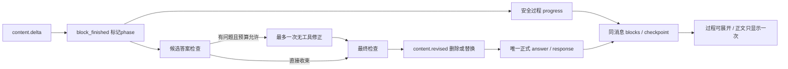

# Execution Event Contract

更新时间：2026-11-07。实现与发布验证范围见[本次记录](reports/2026-11-07_natural_response_compute/README.md)。

## 默认原生研究事件

`POST /api/execute` 默认使用 `backend/agent_runtime/`；`FINSIGHT_RESEARCH_RUNTIME=legacy` 才使用六节点图。原生流使用 `schema_version="2"`，事件包括 `run_id`、`session_id`、`message_id`、`attempt_id`、`stream_epoch`、`event_id`、`seq`、`agent_id`、`parent_agent_id`、`timestamp` 与 `payload`。身份与序列共同约束前端消费，旧 run、旧 epoch、重复事件或其他消息不能污染当前正文。

| 原生 type | 内容与消费 |
|---|---|
| `run.accepted` | 运行开始与实际模型 |
| `activity.started/updated/finished` | 实际活动/恢复说明；普通 `*_model` 占位不作为重复进度行，真实思考由 reasoning block 展示 |
| `content.delta` | 正文 block 的真实增量；兼容 SSE 顶层为 `type=token`、`runtime_type=content.delta` |
| `content.block_finished` | `{block_id, content_phase}` 标注该块为 `progress` 或 `answer`；不要求携带 content，不能据此清空已有文本 |
| `content.revised` | 同 block ID、递增 revision，携带替换后的 content 与 phase；content 可以为空，不自动生成撤回占位 |
| `tool.started/result/failed` | 实际工具状态、逐项注册的 `display.target/result`、脱敏 `inputs`、真实 `output_preview`、`sources` 与失败原因 |
| `agent.started/finished`、`agent.message` | 专业角色生命周期与定向消息；回执不能当作研究结论 |
| `instruction.applied` | 已接收的追加要求在模型边界应用 |
| `skill.activated` | 当前主/专业 Agent 已加载的真实 manifest 方法，不改变执行权限 |
| `artifact.ready` | 真实 dataset 生成的图表或表格，图表包含按字段统计的 coverage 与缺值 limitations |
| `action.proposed/finished` | 需确认的操作及最终收据 |
| `reasoning.delta/completed` | 默认供应商思考增量与结束/时长，`payload.kind=provider_raw`；owner 私有保存，总 20,000 字符上限 |
| `delivery.persistence_unconfirmed` | checkpoint 保存未确认，保留当前页面内容，不宣称已保存 |
| `snapshot.reset` | 服务器已提交 blocks 与水位；替换对应运行快照，随后消费新事件或终态 |
| `done/error/cancelled` | 原生与 legacy 共用的终态与保存状态 |

按本轮用户授权，正文、artifact、action 和 reasoning blocks 随 checkpoint 与终态持久保留。provider reasoning 默认展示，不依赖前端复选框；单 run 包含子 Agent 合计最多 20,000 字符，服务端展示投影与权威消息保存再次限额。reasoning block 保留 `id/kind/reasoning_kind/agent_id/agent_label/provider/content/truncated/duration_ms/revision/seq`，严格绑定 owner/run/message，历史恢复可展开。

思考不进入金融 evidence/Claim、引用、普通回答复制、公开报告或日志。页面运行时思考区最高 160px 内滚，结束折叠并可展开；没有真实字段不生成思考内容。旧版显式开启且仅内存的协议属于历史，不能覆盖本轮已授权合同。

### 文本阶段与一次修正

持久 text block 包含 `id/kind/content/revision/seq/content_phase`，其中 phase 为 `progress` 或 `answer`。工具调用前后的安全说明、等待子研究任务的候选和准备修正的早期回答保留为 progress；交付层选择唯一正式 answer。`content.delta` 尚无 phase 时按旧版 answer 兼容，随后 block_finished/revised 可更新 phase，并保留该块的首次 seq。

前端 `researchText()` 只拼接非 progress 文本；普通复制、会话摘要和下一次请求历史使用最终 `response`/answer。progress 按 seq 在可展开的过程区域弱化展示，不能再次作为主答渲染；`content.revised(content="", content_phase="progress")` 后不显示空块或“已撤回”占位。旧数据库记录不因新文案被重写，也不恢复已经丢失的文字。



修正只对主研究员执行一次，仍受原 run 的截止时间、token 和服务配额约束；不提供工具 schema，模型即使返回 tool_calls 也不会执行。修正失败/超时可回到受检查的候选，但失败修正轮的半截输出不进入正式答案。仍有无法支持的结论时保留 quality 原因、partial/阻断状态，系统仅在末答追加一条限制说明，不逐段插入撤回提示。`metrics.answer_repair_attempted` 记录是否尝试，不代表修正一定成功。

原生路径在正文、reasoning、工具结果/失败和 Agent 结束边界按至少一秒间隔尝试保存前缀：`attempt_id`、`stream_epoch`、`committed_seq`、安全 blocks 与脱敏活动 `thinking` 写入同一权威消息 JSON，不新建 checkpoint 表。block 首次 seq 和活动 seq 决定正文、工具、思考的穿插顺序；旧无 seq 消息只保留已有顺序。相同 epoch 旧水位不能覆盖新快照，终态不再接受 checkpoint。

终态携带 `blocks/thinking/artifacts/actions`、实际 usage、来自正式 answer 的 `price_levels` 与实际引用的来源投影。引用不复制完整 OHLC/data 大表，完整数据由 `data_ref` 回读；未通过数值/metadata 检查的段落被删除/替换，不保留逐段撤回占位。公开 delta 混入的 DSML 内部标记由流式过滤器清理，不作为工具调用。`done` 和核心图表成功不代表全部候选正文可信。

历史存在已保存thinking但没有可信terminal结束时刻时，只显示“已完成”及实际调用数，不使用Date.now减消息时间冒充研究耗时。此规则适用于新旧消息，不依赖某个历史前端补丁版本。

修正反馈限制为 4000 UTF-8 字节，优先已有可验证比较统计，不重复塞入整份长历史或错误候选。`comparison_stats` 预览单独从根层投影，真实交叉日期不能只折叠成条目数；该压缩不改变原始数据和调用预算。

### 追加要求、确认与续研

| 入口 | 请求与边界 |
|---|---|
| `POST /api/execute/runs/{run_id}/instructions` | `instruction`、`instruction_id`；同 owner 的活动 run 接收，同 ID 异文冲突，下一模型边界应用 |
| `POST /api/execute/runs/{run_id}/actions/{action_id}/confirm` | `payload_hash`、`confirmed`；校验 owner/run/action/hash，持久收据幂等处理 |
| `POST /api/execute` 的 `resume_from_run_id` | 新 run 引用同 owner/session 的旧 run；复用未过期的原始资料，不重启旧付费运行 |
| 认证后的 `GET /api/skills` 与 `POST /api/execute` 的 `skill_ids` | 真实7项manifest，匿名401为预期；最多3项、未知ID拒绝，主/专业均可use_skill |

当前写操作只允许 `watchlist.add/remove`。完整匹配动作与 ticker 的真实用户当前消息、或已应用追加要求可复用明确授权；其余提案需确认。网页、工具数据、检索结果和同伴消息不能授权。动作收据区分 `proposed/executing/completed/failed/cancelled/expired`，未完成收据不重放写操作，也不显示成功。

普通追问无需续研 CTA：持久执行在没有显式恢复标识时查找同 owner/session、序列早于当前且已终态的 run；只继承未过期记录，`record_expires_at` 保留原值，不在新快照续期。原始资料在 `FINSIGHT_ARTIFACT_DIR` 的初始 TTL 为 12 小时，过期或不可恢复时重新取证，最新行情不因继承免于重取。失败原位重试保留原 query/技能，内部恢复字段不能注入人造问题。

旧图只有在全部 dataset_refs 仍有效时进入 `prior_artifacts`，保留 spec、coverage、method、limitations 等可验证投影，最多 30 项。它用于核对“刚才图中的均线/缺值/范围”等追问，不复制原图 rows，不发送新的 artifact.ready，不把旧图冒充重新计算的结果。

续研 catalog 只暴露 `status=success` 且 `source_refs` 非空的资料；control 与失败回执仍可用于诊断，但不混进模型的可用资料目录。prior 图投影和当前 run 的新 artifact.ready 必须区分，不能用继承记录伪装本次成功交付。

动作收据与额度租约分别由 `FINSIGHT_ACTION_STORE`、`FINSIGHT_RUNTIME_QUOTA_DB` 的 SQLite 文件跨同目录进程共享。权威消息、私有思考和运行状态仍由 PostgreSQL 保存；这些机制不代表支持多机任务恢复。

## 完成与交付状态

legacy 的 `pipeline_stage(stage=done)` 只说明流程已结束，不能把前端运行提前设为 100%。最终 `done` 到达且答案已经应用后才切换完成；保存中的用户文案为“正在保存回答…”。原生界面使用实际活动，不制造固定阶段百分比。SSE 收到最终 `done/error` 后立即结束读取，不等待 HTTP EOF。

若流程已结束但流未收尾，前端只读同一 `run_id` 的持久终态，校验 session/user message 身份后恢复服务器正文，不发起第二次研究。恢复后关闭网络流不代表用户取消，不调用业务取消接口。聊天回复占位丢失时，仅当对应问题、owner、run、控制器和运行状态仍一致才允许恢复正文；删除、清空、换账号或新的运行接管后不能复活旧回复。

旧客户端未发送消息 ID 时，服务器可能在本地问题快照后补建带 run 的问题/回答。历史恢复以本地问题 ID 精确定位，允许其末尾紧邻一组或多组同文且绑定一致的完整 canonical 问答；只在本地呈现合并最前面的 legacy 副本，保留所有真实运行记录。不同问题、缺失绑定、未完成尾部、换账号或新消息均禁止覆盖，不依赖客户端时钟。

本契约约束后端执行事件、SSE 序列化和前端消费。事件是可观测事实，不是前端模拟动画。

legacy 内容完成度由验证节点产出 `content_contract_version=research_content.v2` 与 `content_status`，同时兼容 `answer_status`。状态为 `answered/partial/unavailable/blocked/clarification_required`；来源 `pass/warn/block` 和 `publishable` 独立。原生路径使用终态 `answer_status`、quality 和已核验 blocks，不冒充已经经过 legacy 逐需求验证节点。前端直接使用服务端判定，缺少版本字段的旧报告只做展示兼容推断。

普通研究180秒、报告300秒，模型预检与研究共享 `RunContext` 截止时间。原生到期保留已流出正文及 blocks/artifacts，并保存失败或取消预览。以下语义抽取、逐任务投影和阶段预算属于 legacy：语义报告模式按本轮原始起点调整预算，到期停止新增模型调用，已完成步骤用确定性投影保留事实及缺项；终态 `error` 携带 `run_deadline_exceeded`、`response`、`task_results` 和 `publishable=false`。投影最多3秒、终态保存最多2秒；保存失败如实标为 `persistence_status=failed`，不能宣称可恢复。

请求理解、限流等待及一次结构修复共用阶段截止时间，默认不超过60秒及进入阶段时整轮余量的三分之一。语义未确认时，原始要求仍是完成度分母，不能用备用估值任务代替营收、同比等要求。没有已核验事实的超时保留明确说明，不能将空白正文保存为已回答。

## Legacy 阶段

`planning`、`executing`、`synthesizing`、`rendering`、`persistence`、`done`、`cancelled`。`done` 完成阶段与终态事件在持久化回调返回后交付；不能在浏览器仍未拿到可恢复答案时提前宣称已保存。

## Legacy 用户级事件

| type | 作用 |
|---|---|
| `pipeline_stage` | 阶段状态与耗时 |
| `plan_ready` | 已验证计划、选择/跳过的 Agent 和并行信息 |
| `step_start/done/error` | 计划步骤生命周期 |
| `agent_start/done/error` | Agent 生命周期 |
| `decision_note` | 不含 chain-of-thought 的决策摘要 |
| `trace` | `visibility=user` 的可解释进度 |
| `token` | 流式文本 token |
| `degraded` | LLM router、直接回复或合成不可用，本轮使用了明确披露的回退 |
| `quality_blocked` | 内容质量未通过，保留可展示预览及原因 |
| `done/error/cancelled` | 运行终态；内容质量和保存状态使用独立字段 |

legacy 的 `llm_*`、`tool_*`、`cache_*`、`data_source`、`api_call` 等细节只在 raw/dev 模式保留；原生的用户活动与安全工具摘要按上表消费。

## 基础 payload

```json
{
  "type": "pipeline_stage",
  "stage": "executing",
  "status": "start|running|done|error|resume|cancelled",
  "message": "正在执行已确认计划",
  "duration_ms": 1234,
  "timestamp": "ISO-8601",
  "run_id": "...",
  "session_id": "...",
  "seq": 12
}
```

事件新增字段应向后兼容；消费者必须忽略未知字段。不得在 payload 中放 API key、Authorization、Cookie、完整敏感工具参数或跨用户数据。

## `degraded` 与终态

```json
{
  "type": "degraded",
  "message": "LLM 暂时不可用，本轮已使用降级回答；结果可能不完整，请稍后重试。",
  "degradation": {
    "used": true,
    "stage": "routing|direct_reply|synthesis|runtime",
    "reason": "llm_unavailable|all_llm_attempts_failed"
  }
}
```

流式 `done` 返回 `degraded: boolean` 与 `degradation: object|null`。选定模型仍由请求上下文统一传入各 LLM 调用；允许的重试最终成功不等于整轮失败。若本轮所有 LLM 尝试均失败并使用规则、工具或模板结果，则以 `runtime/all_llm_attempts_failed` 披露。降级回答仍可展示，前端必须显示具体原因，不能伪装成正常模型成功。

终态的三个维度必须分开消费：

| 字段 | 语义 |
|---|---|
| `run_status` | `running/completed/failed/cancelled/interrupted/persistence_failed`；研究执行与交付生命周期 |
| `quality.state` | `pass/warn/block`，由统一裁决按最严重状态合并 |
| `answer_status` | `answered/partial/unavailable/blocked`，表示请求答复完整性；占位消息为 `running` |
| `has_supported_content` | 是否存在受支持的可展示内容 |
| `persistence_status` | `saved/failed/ephemeral`，分别表示服务器事务已提交、保存失败、无持久存储的匿名或开发运行 |
| `publishable`、`archived` | 内容可发布与报告已归档，两者不可混用 |

`done` 包含 `response`、`report` 或 `blocked_report`、质量原因和 metrics。质量阻断的报告仅为预览；完整报告需要规范化受支持 Claim。`report=None` 不能覆盖聊天已有质量状态。保存失败时正文预览仍在，`publishable=false`，错误码为 `conversation_persistence_failed` 或报告归档的 `report_persistence_failed`。

## 消息与运行身份

`POST /api/execute` 可携带以下字段：

```json
{
  "query": "英特尔的技术面、基本面、催化和风险分别如何？",
  "session_id": "public:USER_ID:THREAD_ID",
  "run_id": "CLIENT_RUN_ID",
  "client_user_message_id": "USER_MESSAGE_ID",
  "client_assistant_message_id": "ASSISTANT_MESSAGE_ID"
}
```

owner 只来自已验证身份。模型预检后，服务器先保存问题、运行和包含 `run_id/reply_to/isLoading=true` 的助手占位，再启动研究。终态事务更新权威助手消息、会话版本及运行 final payload，提交后返回：

```json
{
  "type": "done",
  "run_id": "CLIENT_RUN_ID",
  "session_id": "public:USER_ID:THREAD_ID",
  "run_status": "completed",
  "response": "已验证的完整正文",
  "persistence_status": "saved",
  "conversation_version": 2,
  "user_message_id": "USER_MESSAGE_ID",
  "assistant_message_id": "ASSISTANT_MESSAGE_ID",
  "assistant_message": {
    "id": "ASSISTANT_MESSAGE_ID",
    "role": "assistant",
    "content": "已验证的完整正文",
    "run_id": "CLIENT_RUN_ID",
    "reply_to": "USER_MESSAGE_ID",
    "run_sequence": 1,
    "isLoading": false,
    "answer_status": "answered"
  }
}
```

上例省略质量、时间、报告与 metrics 等字段。消息 `timestamp` 为毫秒时间戳；会话及运行 API 的 `created_at/updated_at/completed_at` 为秒时间戳。

相同 owner/run 再次 POST 只恢复原结果，在配额检查与模型预检之前返回；同 run 更换查询返回 409。用户主动重新生成必须新建 run 和 assistant ID，可复用 user message ID。历史运行审计保留，会话按 `reply_to` 最新 `run_sequence` 原位显示回复，迟到旧 run 不覆盖新结果。

会话快照写入采用事务合并，权威消息优先。客户端可提交 `expected_version`，过期时返回 HTTP 409 `conversation_version_conflict`，随后读取最新版本；不传版本的旧客户端也不能用旧快照抹去服务器回复。

## Legacy `plan_ready`

```json
{
  "type": "plan_ready",
  "plan_steps": [
    {"id": "s1", "kind": "agent", "name": "news_agent", "task_ids": ["task_1"], "parallel_group": "research", "optional": false, "depends_on": [], "data_dependencies": []}
  ],
  "selected_agents": ["news_agent"],
  "skipped_agents": [{"agent": "macro_agent", "reason": "not_needed"}],
  "has_parallel": false,
  "reasoning_brief": "选择新闻证据以回答事件问题",
  "timestamp": "ISO-8601"
}
```

`reasoning_brief` 只能是可披露决策摘要，不输出隐藏思维链。

计划必须已通过工具实际 schema、任务/依赖引用和无环校验。`depends_on` 要求上游成功，`data_dependencies` 只等待上游成功或失败结束；前端不得按展示分组推断真实依赖。

## 取消与续传

- 前端停止时先中止 SSE，并调用后端取消作用域。
- execution service、图节点、executor 和 Agent adapter 共享 cancellation token。
- 取消不是普通错误；后端发出 `cancelled` 阶段并停止后续 step/agent 事件。
- 已产生的可见事件可保留；取消后到达的外部调用结果不得继续进入 evidence/synthesis。
- SSE 续传必须按 run/thread/user scope 校验，不能跨会话重放。

`GET /api/execute/runs/{run_id}` 返回 `{run_id,session_id,status,user_message_id,assistant_message_id,created_at,updated_at,completed_at,result}`。`result` 在 running 时为 null，结束后为完整终态事件；不返回 worker ID 或私有请求上下文。

`GET /api/execute/runs/{run_id}/events?after_seq=N` 优先读取内存事件；缓冲过期或进程重启后，从 PostgreSQL 读取已提交 checkpoint 或终态。原生有 blocks 时先发送 `snapshot.reset`，终态标注 `recovered=true` 并给出大于 cursor 的 seq。恢复不重新执行研究。运行每 25 秒续期，90 秒租约失联且被读取后转为 `interrupted`，保留已提交正文与 blocks 并保存可重试说明。

数据库完全不可写时，临时预览无法承诺跨进程恢复；前端提示保留当前内容，不能显示“已保存”。取消/中断时已流出的正文仍作为失败预览保存。执行 task 与取消路由仍在单个 backend 进程，终态持久化不代表已实现分布式任务调度。

## 前端消费

- user：阶段和当前步骤。
- expert：阶段、分组时间线、Agent 选择和统计。
- dev：允许显示 raw 事件，但仍需脱敏。
- 优先采用 `assistant_message.content` 或终态 `response` 校准流式正文；重复 done 根据消息/run ID 幂等合并。
- `persistence_status=saved` 时无需由浏览器再写最终正文；failed 保留预览并提示，ephemeral 不显示持久保存承诺。
- 刷新后遇到服务器占位，按 run ID 查询状态或续传，不再次 POST 新研究；同 owner 的 token 刷新不能切走当前会话。
- 前端附加图表标记是展示补充，不能通过迟到整份快照覆盖服务端权威正文；永久图表依赖服务器 artifact 或明确的 view metadata。

原生事件生产位于 `backend/agent_runtime/loop.py`、`tools.py`、`service.py`，回放与保存适配位于 `backend/api/execution_router.py`、`backend/services/research_run_store.py`。legacy 事件仍由 `backend/graph/event_bus.py`、`backend/graph/execution/`、`backend/graph/nodes/` 和 `backend/services/execution_service.py` 生产。前端原生 blocks 消费位于 `frontend/src/store/researchStream.ts`、`hooks/useChatStream.ts` 和 `types/runtime.ts`；修改事件必须同时更新两端类型和测试。
