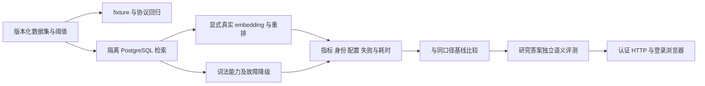

# RAG 评估指南

评估合同创建于 2026-10-03；当前接线与执行规范校准于 2026-11-13，历史实测保留原日期和范围。

RAG 存储为 PostgreSQL + pgvector；代码默认词法检索，可显式选择托管 embedding/rerank 或独立私网 local-ml worker。评估必须分别记录语义检索、词法降级及显式 CI hash 配置，不能把三者的通过结果互相替代。`ready=true` 可能只代表持久词法检索可用，必须同时检查 `semantic_ready/lexical_ready`。新研究运行时尚未部署，旧 RAG 结果不替代 M3/M4 或 48 项最终验收。

## 指标

| 层 | 核心指标 |
|---|---|
| 检索 | Recall@K、Precision@K、MRR、nDCG、空结果率、P95 |
| 生成 | Faithfulness、Answer Relevancy、Context Precision/Recall、Citation Coverage |
| 金融事实 | 发行人/标的、指标定义、实际财期、单季/累计、同比/环比、单位/币种、as-of、引用支持论据 |
| 安全 | user/thread/run 隔离、敏感元数据脱敏、诊断接口认证 |
| 稳定性 | PostgreSQL 故障、worker 中断/重启/OOM、NULL 向量与词法降级、重复摄取和并发一致性 |
| 向量身份 | model revision、编码配置、维数与 `metadata.embedding_identity` 一致；未知/不同身份不得进入 Dense 比较 |

## 评估集要求

评估集应覆盖价格、新闻、财报、宏观、风险、公告/网页、中文/英文、多标的、无答案、冲突来源、过期文档和恶意 scope。每条样本记录原始 query、任务/主体/证据维度、期望 source id、ground truth（如适用）、财期/单位和允许的无答案行为。纳入错发行人年报、累计财务值、非日历财年、同维不同模型以及旧未知向量身份的反例。

禁止用生产秘密或未脱敏用户数据制作 fixture。

## 运行

仓库当前评估入口位于：

- `tests/retrieval_eval/`：检索 gate 与报告；
- `tests/rag_quality/`、`tests/rag_qualityV2/`：生成与质量评估；
- `backend/tests/`：RAG 服务、scope、PostgreSQL 和执行接入测试。

先运行受影响的定向 pytest，再在发布前运行对应 gate。命令以各目录脚本/README 和 CI 为准，不在本文硬编码可能过时的通过数量。

托管语义模式通过实际配置的 API 做受限验证；local-ml 只向私网 worker 发受限推理请求，不在主 backend 或额外 QA 进程加载 BGE/reranker 副本。分别记录实际模型 revision、配置、资源峰值和健康状态。若硬件无法完成本地推理，按“语义未验证，词法降级已验证”记录，不能悄悄改为 hash 后写语义通过。

首次模型加载要求宿主 `MemAvailable` 和 cgroup 剩余内存均达到默认 2400 MiB 门槛。测试资源不足时应观察 `resource_limited/inference_verified=false`，确认 API 的词法降级；这验证了资源保护，不能记作 BGE 推理通过。2026-10-03 历史预检总内存约 3.32 GiB、其他业务占用后可用约 600 MiB，仅是当时快照；当前资源须重新测量，不清理其他业务容器或擅改全局限流来凑条件。

### 分层执行与报告



检索入口 `tests/retrieval_eval/run_retrieval_eval.py` 接受 dataset、thresholds、baseline、backend、top-k、citation-top-k 及输出目录。`--gate` 检查绝对阈值，`--drift-gate` 检查相对基线；基线缺失显示 skipped，不算漂移通过。其默认 backend 为 memory，发布验证必须显式选择隔离 PostgreSQL，不能因命令成功误报生产存储通过。

先在测试环境运行：

```bash
python -m pytest -q backend/tests/test_knowledge_api_tools.py backend/tests/test_rag_postgres_isolation.py tests/retrieval_eval/test_retrieval_eval_runner.py
```

真实检索 gate 使用隔离 QA 数据库及该环境的安全配置：

```bash
python tests/retrieval_eval/run_retrieval_eval.py --backend postgres --postgres-dsn "$RAG_V2_POSTGRES_DSN" --gate --drift-gate
```

结果保存 JSON、Markdown 和 gate summary，记录实际 backend、fallback_reason、embedding model/dim、数据集版本、阈值、基线可用性、分组指标和失败项。DSN 与 API key 由环境提供，不写入报告。不可把此命令直接指向生产业务库写入评测语料。

当前研究独立使用 `tests/agent_eval/` 的工具录制/回放与评分；检索 Recall 通过不代表完整答案忠实、引用支持或交付完成。新 APIKL 模型真实工具/SSE 探针、完整 60 题配对质量与认证用户 48 项验收分别留证，当前后两项仍在进行或未执行。

## 判定原则

- 阈值由版本化评估配置/CI 定义；文档不复制一次性跑分作为永久事实。
- 模型、embedding、chunk、reranker、top-k、过滤或 schema 变化必须与上一个生产基线对比。
- 平均分通过但关键金融事实错误、跨用户泄露或 Citation Coverage 不达标，仍判失败。
- 无答案样本应奖励正确拒答/披露，不能逼迫模型猜测。
- 记录模型、数据集版本、commit、配置、耗时和失败样本，确保可复现。
- 记录接口层级：fixture、服务层真实供应商、完整认证 HTTP、登录浏览器、生产语义 RAG 各自独立；服务层通过不代表完整用户链路通过。
- 输出非空、引用数量、HTTP 200 和容器 healthy 不是研究质量标准。必须逐项核对主体、财期、维度、论据支持、质量阻断和最终回答恢复。

## 变更门禁

- [ ] 摄取/去重/scope 定向测试通过。
- [ ] 维数与 pgvector schema 一致，实际 `embedding_identity` 相同才可 Dense 检索。
- [ ] 未知身份旧向量保留且不进入 Dense，显式 hash 不污染 BGE 空间。
- [ ] 检索指标未显著回退，关键样本全部通过。
- [ ] 生成忠实度、引用和数字一致性通过。
- [ ] worker 不可用时 NULL 向量摄取与 scoped lexical 工作，健康状态明确语义降级。
- [ ] PostgreSQL 不可用时生产 readiness 失败，不能以内存替代。
- [ ] 真实 worker 推理或硬件导致的明确未验证结论有记录。
- [ ] 受保护的运维查询、日志与评估产物通过 scope 隔离和脱敏检查。

2026-10-03 的历史外部验证状态保留在[原发布归档](archive/2026-10-03-foundation-refactor/README.md)；当前实施与待验项见[运行手册](11_PRODUCTION_RUNBOOK.md)，不预填未完成的生产/数据库/语义验证结果。
