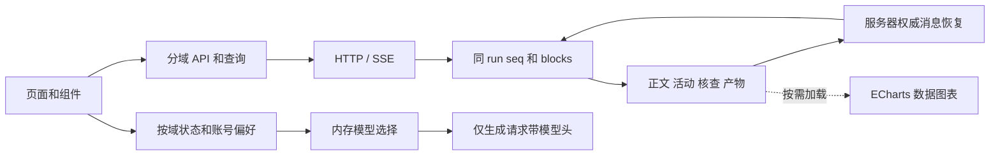

# FinSight 前端

更新：2026-11-13。React 19、TypeScript、Vite、Tailwind 与 Zustand。当前布局和研究事件见[设计合同](../DESIGN.md)与[架构](../docs/01_ARCHITECTURE.md)；实际部署与登录验收见运行手册。

## 页面与身份

| 页面 | 边界 |
|---|---|
| Today | 根路径默认入口；个人摘要使用当前登录身份 |
| Dashboard | 真实行情/财务/新闻/技术指标，结构化 Ask AI handoff |
| Chat | 原生研究、追加/停止/确认/续研和报告 |
| History | 已保存会话、报告与用户 Prediction/Outcome |
| TrackRecord | 固定 US20 公开统计，与个人预测分开 |
| Welcome/Login | 实际 Supabase 登录；未配置 provider 不展示假按钮 |
| `/share/r/:token` | 公开、只读、字段受限的分享报告 |

Chat/History 使用真实认证。body、session 和缓存不能覆盖服务端 owner；切账号清理会话、资料和临时模型凭据，同账号令牌刷新保留自己的有效状态。认证夹具只用于确定性集成测试，不证明线上 OAuth 或跨账号隔离通过。

## 数据流与目录



| 位置 | 责任 |
|---|---|
| `src/pages/`、`components/layout/` | 页面、工作区外壳、响应式导航和右栏 |
| `components/ChatInput.tsx`、`hooks/useChatStream.ts` | 输入、报告模式、受理与运行生命周期 |
| `components/chat/` | 正文、单行活动、来源、核查、修订和真实产物 |
| `api/domains/`、`api/queries/` | 分域请求与查询；client.ts 保留兼容出口 |
| `api/sse.ts`、`store/researchStream.ts` | 事件解析、序号、blocks 与终态合并 |
| `store/useStore.ts` | 组合 chatSession/conversations/composer/theme/auth slices |
| `store/conversationPersistence.ts` | 服务器恢复与账号范围持久化 |
| `store/modelSelection.ts`、`researchPreferences.ts` | 账号模型偏好、自选免确认和研究设置 |
| `components/agent-log/` | 独立诊断视图，不维护第二条执行流 |
| `components/charts/EChart.tsx`、`InlineChart.tsx` | 按需加载图表与数据产物 |
| `locales/zh.ts` | 固定用户文案 |

旧 components/execution 和 executionStore 已退役。原生运行不从正文标记触发工具或补图；没有 blocks 的历史消息保持展示兼容。整数来源对应真实账本，核查逐字引用原回答，修订保留旧版。

## 开发与验证

Node.js 20.19+ 或 22.12+，使用当前 npm 锁文件。

```bash
npm ci
npm run dev
npm run test:unit
npm run lint
npm run build
npm run test:e2e
```

Playwright 配置自行启动 `127.0.0.1:4273`；本机有 Edge 可设置 `PLAYWRIGHT_CHANNEL=msedge`。按变更运行相关测试；完整模型质量与真实用户验收另见[评测说明](../tests/agent_eval/README.md)。不沿用旧日期 audit 数量声明当前依赖安全。

VITE_API_BASE_URL 和 Supabase 公开项目 URL/publishable key 可进入前端；服务端模型 key、worker token、数据库 DSN、Supabase secret/service role key 留在服务器。自定义模型 key 仅在页面/请求内存，不能写 localStorage、消息或公开请求。

正文首增量、工具活动、正文完成、核查、持久化和唯一终态分别处理。停止保留部分内容，断线恢复同 run，保存失败不把历史标成功。表格/图表横滚限于自身容器，支持键盘、中文 IME、aria-live 活动和减少动画。

## 样式与发布

index.css 定义唯一主题变量和正文 fs-prose，按用途拆分的 CSS 管公共组件，ChatDesign.module.css 管对话布局。语义色与字体见[Token 说明](src/styles/tokens.md)，修改遵循现有设计合同，不另建主题。

构建生成 app-version.json，发布与实际镜像绑定，构建成功不等于上线。HTTP/SSE/产物、恢复和发布门槛见[事件合同](../docs/execution-event-contract.md)、[图表规范](../docs/REPORT_CHART_SPEC.md)与[运行手册](../docs/11_PRODUCTION_RUNBOOK.md)。
